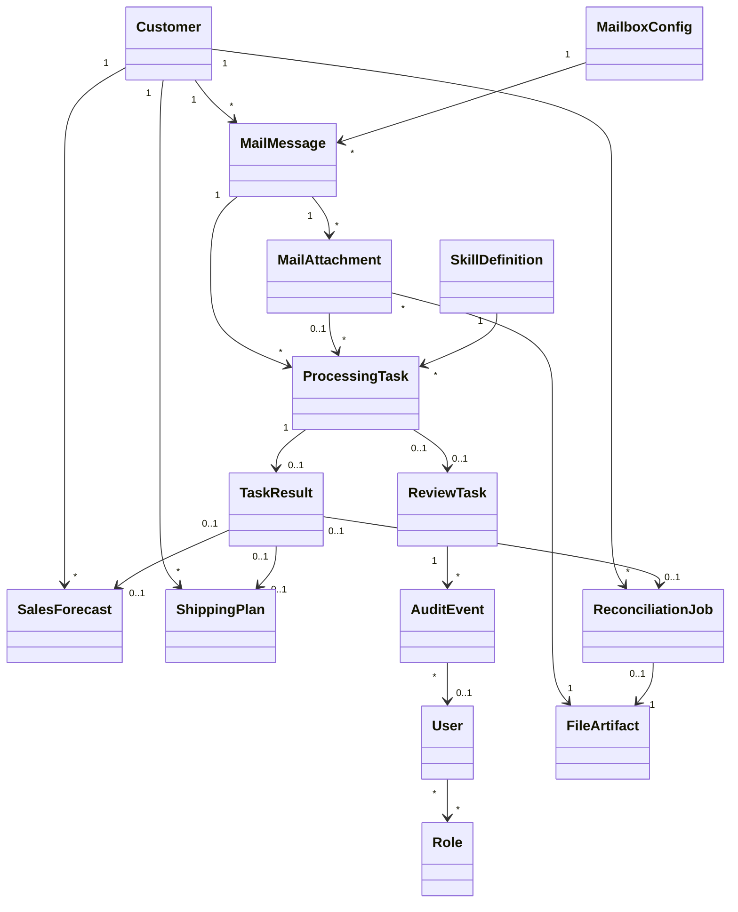

# Server Domain Requirement

Target project location: `server/docs/domain-requirement.md`

Status: Draft v0.1.

## Purpose

This document defines the server-side domain model for Supply Chain Agent.

The server owns business truth, mail operations, customer recognition, processing state, review state, standardized order data, reconciliation state, file/export metadata, and audit records.

The worker only returns extraction outputs, confidence, source references, trace steps, warnings, and errors. The worker must not directly confirm final business records.

## Domain Ownership

Server owns:

- Users, roles, and page-level permissions.
- Customer, embedded contact, material mapping, mailbox, template rule, and schedule configuration.
- Mail ingestion state.
- Customer recognition evidence.
- Submission context as an embedded value object.
- Duplicate and revision detection.
- Processing task lifecycle.
- Worker result ingestion.
- Human review task and decision.
- Standard `sales forecast` and `shipping plan` records.
- Skill metadata, versioning, sandbox test result, and active state.
- Customer analytics read models.
- Financial reconciliation jobs with embedded comparison rows, remarks, and reports.
- File artifact metadata for sources, exports, and reports.
- Audit events and retention visibility.

## Entity Design Principles

- Backend requirements must be domain-driven, not page-driven.
- Define aggregate roots before endpoints.
- Keep raw source evidence separate from normalized business records.
- Preserve source reference for every AI-generated or human-corrected value.
- Store standard business output in normalized structures, even if exported Excel uses matrix-style templates.
- Use soft delete and retention visibility rather than destructive deletion.
- Treat AI extraction as evidence, not final business truth.
- Treat human review decisions as auditable domain events.

## Core Domain Boundary Review

The domain should stay centered on a small set of business truth entities. Frontend cards, heatmaps, attention lists, weekly charts, comparison tables, and dashboard summaries are read models unless explicitly stated otherwise.

### First-Version Persistent Collections

These are the first version's recommended persistent collections:

| Collection | Responsibility |
| --- | --- |
| `User` / `Role` | Internal access control and audit identity. |
| `Customer` | Owns customer context, customer code, contacts, material mappings, submission schedules, and customer-specific rules. |
| `MailboxConfig` | Owns the single listener mailbox and retention settings. |
| `MailMessage` | Preserves the original inbound email metadata and body reference. |
| `MailAttachment` | Preserves source attachment metadata and connects the attachment to stored file evidence. |
| `ProcessingTask` | Owns the lifecycle of work the server asks the worker or business pipeline to execute. |
| `TaskResult` | Stores worker or pipeline output as evidence, not final business truth. |
| `ReviewTask` | Represents a human decision gate when the pipeline cannot continue safely. |
| `SalesForecast` | Stores confirmed weekly forecast output. |
| `ShippingPlan` | Stores confirmed daily firm/shipping output. |
| `SkillDefinition` | Stores skill status and versions for historical traceability. |
| `ReconciliationJob` | Stores one finance reconciliation session, uploaded target file, comparison rows, and remarks. |
| `FileArtifact` | Stores object-storage metadata for raw files, snapshots, screenshots, traces, exports, and reports. |
| `AuditEvent` | Stores auditable system and user activity. |

### Embedded Records And Value Objects

The following concepts should not become top-level collections in the first version. They should be embedded records, value objects, or generated read models:

- `Customer.contacts[]`, `MaterialMapping`, `SubmissionSchedule`, and `TemplateRule` are embedded under `Customer` or system configuration.
- `MailRecognitionEvidence` is embedded under `MailMessage` or stored as a `TaskResult` from `emailBodyAnalysis`.
- Embedded `submissionContext` is a value object that groups customer, source mail, source attachments, document type, period, and duplicate/revision signals. It must not own an independent lifecycle.
- `TaskResult.sourceReferences[]` and `TaskResult.traceSteps[]` are embedded under `TaskResult`.
- `ReviewTask.decisions[]` is embedded under `ReviewTask`.
- `ForecastLine` and `ForecastQuantity` are embedded under `SalesForecast`.
- `ShippingPlan.lines[]` is embedded under `ShippingPlan`.
- `SkillDefinition.versions[]`, `SkillDefinition.testRuns[]`, and `TaskResult.skillExecutions[]` are embedded under `SkillDefinition`, `TaskResult`, or `ProcessingTask` depending on where the evidence belongs.
- `ReconciliationJob.targetFile`, `ReconciliationJob.comparisonLines[]`, and `ReconciliationJob.remarks[]` are embedded under `ReconciliationJob`.
- Generated exports and reports are represented by `FileArtifact.artifactType = export` or `report`.

### Read Models And Optional Caches

These concepts should be returned by query services. They should not be implemented as persistent collections unless performance later proves that a cache is necessary:

- `MailAttentionItem`
- `CustomerMailActivity`
- `HumanInterventionTaskItem`
- Customer analytics summary read model.
- Customer recommendation read model.
- Reminder item read models for not-yet-sent reminders. Approved or sent reminders should be recorded through audit/outbound mail records.
- Dashboard summaries, weekly heatmaps, forecast curves, and reconciliation comparison views.

### Status Ownership Rules

Status ownership must be explicit:

- `ProcessingTask.status` is the source of truth for pipeline execution state: whether work has started, is queued, is running, is waiting for a human decision, completed, failed, or cancelled.
- `ReviewTask.status` is the source of truth for human decision state.
- `MailMessage` should not own a separate processing lifecycle. Mail-level status in the UI must be derived from related `ProcessingTask`, `TaskResult`, `ReviewTask`, and attachments.
- Embedded `submissionContext` should not have a status. Duplicate/revision/new/ambiguous is represented by `submissionKind` inside the context or latest task result.
- `SalesForecast` and `ShippingPlan` own confirmed standardized business data after server validation and human confirmation when needed.
- Read models such as `MailAttentionItem`, `CustomerMailActivity`, `HumanInterventionTaskItem`, and reconciliation comparison tables should not become independent aggregate roots in the first version.

## Entity Groups

| Group | Persistent collections |
| --- | --- |
| Identity and permission | `User`, `Role` |
| Master data and configuration | `Customer`, `MailboxConfig` |
| Mail intake | `MailMessage`, `MailAttachment` |
| Processing and evidence | `ProcessingTask`, `TaskResult` |
| Human review | `ReviewTask` |
| Standard order data | `SalesForecast`, `ShippingPlan` |
| Skill studio | `SkillDefinition` |
| Financial reconciliation | `ReconciliationJob` |
| Artifact and audit | `FileArtifact`, `AuditEvent` |

## Input / Task / Output View

This model should be reviewed from the business flow first, not from individual database tables.

The simplest mental model is:

```text
Input
  -> Task
    -> Task result and source evidence
      -> Human review, when needed
        -> Final standardized business output
```

### Input Layer

Input records preserve what the customer submitted.

Records and value objects:

- `Customer`
- `MailMessage`
- `MailAttachment`
- `FileArtifact`
- embedded `submissionContext`

Typical input fields:

- Customer ID.
- Customer name.
- Sender email.
- Mail received time.
- Mail subject.
- Mail body.
- Attachment metadata.
- Attachment file content.

Embedded `submissionContext` is used by mail, task, result, and final output records. It answers:

- Which customer submitted this material?
- Which period does it belong to?
- Is it a new submission, duplicate, revision, or ambiguous submission?
- Which email, body, and attachments are involved?

### Task Layer

Task records describe what the system needs to process.

Persistent collection:

- `ProcessingTask`

Typical task fields:

- Task ID.
- Task type.
- Task status.
- Task start time.
- Task end time.
- Source entity type and source entity ID.
- Related customer submission, when the task comes from mail intake.
- Related reconciliation job, when the task comes from finance upload.
- Related skill version, when the task comes from Skill Studio generation or sandbox execution.
- Related email body and attachment, when applicable.
- Error code and message.

Supported task types should include:

- `emailBodyAnalysis`: analyze email subject/body for intent, quantity changes, revision hints, and skill candidates.
- `classifyDocument`: classify attachment type and target schema.
- `extractSalesForecastFromExcel`: parse Excel forecast data and produce weekly forecast output.
- `extractShippingPlanFromExcel`: parse Excel firm/shipping plan data and produce daily shipping plan output.
- `extractShippingPlanFromPdf`: parse PDF firm/shipping plan data and produce daily shipping plan output.
- `analyzeRevision`: compare current submission with previous submission and detect duplicate/revision signals.
- `extractReconciliation`: parse uploaded ePortal or shipping-side reconciliation file.
- `generateSkillVersion`: generate a structured skill document and executable rule draft from natural language.
- `executeSkillSandbox`: run one skill version against selected historical customer files for sandbox testing.

### Task Result / Evidence Layer

Task result records store what the worker or server-side processing pipeline found, not final business truth.

Records:

- `TaskResult`
- `TaskResult.sourceReferences[]`
- `TaskResult.traceSteps[]`

For `emailBodyAnalysis`, output may include:

- Document intent.
- Mentioned period.
- Mentioned material.
- Mentioned quantity change.
- Previous quantity.
- New quantity.
- Delta quantity.
- Change direction.
- Whether skill should be called.
- Skill candidates.
- Whether human review is required.
- Confidence.
- Source references.

For `extractSalesForecastFromExcel`, output may include:

- Customer.
- Customer code.
- Material.
- Source dates.
- Daily quantities, if present.
- Weekly quantities.
- Week keys.
- Source cells.
- Confidence.

For `extractShippingPlanFromExcel` or `extractShippingPlanFromPdf`, output may include:

- Customer.
- Customer code.
- Material.
- Shipping date.
- Firm or actual quantity.
- Delivery note.
- Source cells, PDF pages, or PDF regions.
- Confidence.

### Human Review Layer

Human review records capture decisions when AI output or business rules are uncertain.

Records:

- `ReviewTask`
- `ReviewTask.decisions[]`

Human review should be created when:

- Customer is ambiguous.
- Attachment is unchanged but email body says quantity changed.
- Same customer submits the same period again.
- Forecast or firm type is unclear.
- Required fields are missing.
- Quantity is abnormal.
- Template is invalid.
- Reconciliation lines do not match.

### Final Output Layer

Final output records store standardized business data after server validation and human confirmation when required.

Records:

- `SalesForecast`
- `SalesForecast.lines[]`
- `SalesForecast.weekQuantities[]`
- `ShippingPlan`
- `ShippingPlan.lines[]`

Sales forecast is stored as normalized line + weekly quantity records, even if export uses a matrix-style Excel layout.

Shipping plan is stored as daily firm/shipping records. Weekly confirmed views can be derived from daily shipping plan lines when needed.

## Frontend Interaction View

This section maps frontend modules to backend domain concepts. It is used to discover whether a UI action needs persistence, audit, review, or only a query/read model.

### Intelligent Customer Service Workspace

The intelligent customer service workspace is the user's daily operation cockpit.

It should answer:

- What did AI process yesterday?
- Which customers have recently sent emails?
- Which customers may need follow-up?
- Which received mails have blocked the workflow and need user action now?

Recommended layout:

- Left panel: yesterday AI processing summary.
- Middle panel: customer mail activity heatmap.
- Right panel: mail attention items.

#### Left Panel: Yesterday AI Processing Summary

Purpose:

- Show what the AI completed yesterday.
- Show which customers were involved yesterday.
- Keep the left panel as a concise daily handover, not a live operational queue.

Suggested metrics:

- Processed file count.
- Processed email count.
- Involved customer count.
- Successful parse count.
- Failed parse count.
- New mail attention item count.
- Customers that had processed mails yesterday.

Backend source records:

- `MailMessage`
- `MailAttachment`
- `ProcessingTask`
- `TaskResult`
- `ReviewTask`
- `Customer.submissionSchedules[]`

Read model:

```text
YesterdayOperationSummary
  date
  processedFileCount
  processedEmailCount
  involvedCustomerCount
  successfulParseCount
  failedParseCount
  newMailAttentionItemCount
  followUpCustomerCount
  involvedCustomers[]

SummaryCustomer
  customerId
  customerName
  customerCode
  processedMailCount
  processedAttachmentCount
  attentionItemCount
```

Persistence note:

- `YesterdayOperationSummary` does not need to be a persistent entity in the first version.
- It can be computed from existing entities.
- A snapshot can be added later if query performance becomes a problem.

#### Middle Panel: Customer Mail Activity Heatmap

Purpose:

- Show customer email activity by customer and date.
- Help users know when each customer last sent an email.
- Help users identify customers that may need follow-up.
- Highlight expected-but-missing mail based on the customer's configured submission schedule.

Interaction:

- View should be switchable.
- The default view should show recent customer mail activity, such as the last 30 days.
- A compact today view can show today's received mail count per customer.
- Rows represent customers.
- Columns represent dates.
- Cell color depth represents mail count for that customer on that date.
- Cells should be highlighted when a customer was expected to submit mail by schedule but no mail was received.
- Clicking a cell should open a detail sheet showing the related mail list.
- Clicking a mail in the sheet should navigate to the Customer Inbox mail detail so the user can inspect original mail, attachments, and parse status.
- The heatmap should not need an explanatory footer in the first UI; the visual state should be self-evident enough.

Backend source records:

- `Customer`
- `MailMessage`
- `ProcessingTask`
- `ReviewTask`
- `Customer.submissionSchedules[]`

Read model:

```text
CustomerMailActivity
  viewMode
  dateRangeStart
  dateRangeEnd
  customerId
  customerName
  expectedFrequency
  lastReceivedAt
  overdueStatus
  dailyBuckets[]

CustomerMailActivityBucket
  date
  mailCount
  submissionCount
  expectedMail
  missedExpectedMail
  hasException
  latestMailAt

TodayCustomerMailCount
  customerId
  customerName
  mailCount
  expectedMail
  missedExpectedMail
  openMailAttentionItemCount
```

Cell detail sheet should show:

- Customer.
- Date.
- Mail subject.
- Sender.
- Received time.
- Mail body preview.
- Attachment count.
- Related document type, period, and duplicate/revision context.
- Related review task status.
- Link target for Customer Inbox mail detail.

Persistence note:

- `CustomerMailActivity` is a read model, not necessarily a persistent entity.
- Mail persistence should remain in `MailMessage`; submission grouping should remain an embedded `submissionContext`, not a separate collection.

#### Right Panel: Mail Attention Items

Purpose:

- Show received mails that block the downstream workflow until a user makes a decision.
- Keep the list mail-centric: every item should be traceable to one `MailMessage`.
- Clicking an item should open the corresponding Customer Inbox mail detail.

Attention item sources:

- `ReviewTask`
- `MailMessage`
- `MailAttachment`
- `MailRecognitionEvidence`
- embedded `submissionContext`
- `ProcessingTask`
- `TaskResult`
- `TaskResult.skillExecutions[]`

Follow-up reminder boundary:

- Expected-but-missing customer mail is shown in the heatmap via schedule-based highlighting.
- A follow-up reminder can still exist as a reminder read model, but the right panel should not mix no-mail reminder items into the mail attention list unless there is a related received mail.

Sorting rule:

- Do not introduce urgency/priority labels in the first version.
- Sort by related mail received time ascending when available.
- If multiple attention reasons exist on one mail, show one mail item with the highest blocking reason and include the other reasons in detail.

Recommended attention reason categories:

- `skillSelectionRequired`: the agent found multiple applicable skills or needs user confirmation before skill execution can continue.
- `parseFailedRequiresIntervention`: attachment parsing failed and automatic retry is not enough or has already been attempted.
- `sourceConflictRequiresDecision`: email body and attachment content conflict, such as unchanged attachment but body says quantity changed.
- `customerRecognitionRequired`: sender/domain/keyword matching is unknown or ambiguous.
- `duplicateOrRevisionDecisionRequired`: the submission may be a duplicate or revision and requires user judgment.
- `documentTypeDecisionRequired`: the file or mail intent cannot be safely classified as sales forecast, shipping plan, or unsupported.
- `unsupportedOrInvalidTemplate`: the file is processable in principle but does not match a supported template shape.
- `missingBusinessMapping`: required customer/material mapping is missing, such as unknown customer part number or internal material mapping.
- `extractionReviewRequired`: low confidence, missing required value, abnormal quantity, date/period mismatch, or other extracted value requires human confirmation.
- `businessMailWithoutProcessableAttachment`: the email appears to contain forecast/shipping instruction but has no supported attachment or the body-only instruction needs manual handling.

Recommended blocking hierarchy:

```text
customerRecognitionRequired
  -> documentTypeDecisionRequired
  -> unsupportedOrInvalidTemplate
  -> duplicateOrRevisionDecisionRequired
  -> sourceConflictRequiresDecision
  -> skillSelectionRequired
  -> parseFailedRequiresIntervention
  -> missingBusinessMapping
  -> extractionReviewRequired
  -> businessMailWithoutProcessableAttachment
```

The hierarchy is only for display grouping when one mail has multiple reasons. It should not be treated as business priority.

Recommended mapping to `ReviewTask.reviewType`:

| Attention reason | Review type |
| --- | --- |
| `skillSelectionRequired` | `skillSelection` |
| `parseFailedRequiresIntervention` | `parseFailed` |
| `sourceConflictRequiresDecision` | `sourceConflict` |
| `customerRecognitionRequired` | `customerRecognition` |
| `duplicateOrRevisionDecisionRequired` | `duplicate` or `revision`, depending on the detected signal |
| `documentTypeDecisionRequired` | `forecastFirmAmbiguous` |
| `unsupportedOrInvalidTemplate` | `unsupportedDocument` or `invalidTemplate` |
| `missingBusinessMapping` | `missingBusinessMapping` |
| `extractionReviewRequired` | `lowConfidence`, `missingField`, or `quantityAbnormal` |
| `businessMailWithoutProcessableAttachment` | `bodyOnlyBusinessInstruction` |

Read model:

```text
MailAttentionItem
  id
  mailMessageId
  title
  reason
  reasonLabel
  customerId
  customerName
  status
  fromEmail
  subject
  createdAt
  receivedAt
  sourceEntityType
  sourceEntityId
  relatedAttachmentIds[]
  relatedReviewTaskIds[]
  relatedProcessingTaskIds[]
  inboxDetailUrl
```

Attention item status:

- `open`
- `inProgress`
- `resolved`
- `dismissed`

Attention item resolution:

- Resolving the underlying `ReviewTask`, parse retry, customer assignment, skill selection, or duplicate/revision decision should remove the mail from the open attention list.
- The item itself can be computed from underlying entities; it does not need to be a persistent aggregate in the first version.

Persistence note:

- `MailAttentionItem` is a frontend read model.
- Review persistence remains in `ReviewTask` and `ReviewTask.decisions[]`.
- Not-yet-sent reminders should be computed from schedules and mail history. Approved or sent reminders should be recorded through audit/outbound mail records.

#### Page Action / Service Matrix

This matrix defines the first implementation contract between the Intelligent Customer Service Workspace and server daily cockpit services.

Read models required by the page:

- `YesterdayOperationSummary`
- `CustomerMailActivity`
- `TodayCustomerMailCount`
- `MailAttentionItem`

Actions:

| UI action | User intent | Backend service / command | Records read | Records written | State change | Worker/mock dependency | Notes |
| --- | --- | --- | --- | --- | --- | --- | --- |
| Open daily cockpit | Load yesterday summary, customer mail activity, and open mail attention items | `DailyCockpitQueryService.getCockpit` | `MailMessage`, `MailAttachment`, `Customer`, `ProcessingTask`, `TaskResult`, `ReviewTask` | none | none | No | Read-only initial page load. |
| Switch mail activity view | Show recent heatmap or today's customer mail counts | `DailyCockpitQueryService.getCustomerMailActivity` | `Customer`, `MailMessage`, `Customer.submissionSchedules[]`, `ReviewTask` | none | none | No | Can return precomputed buckets later if performance requires it. |
| Open heatmap cell | Inspect related customer mails for one date | `DailyCockpitQueryService.getMailActivityCellDetail` | `Customer`, `MailMessage`, `MailAttachment`, `ReviewTask` | none | none | No | If the cell is missed expected mail, return schedule/reminder context and an empty mail list. |
| Click mail in sheet | Continue inspection in Customer Inbox | Frontend navigation to Customer Inbox detail | `MailMessage` | none | none | No | Should carry `mailMessageId` so the inbox can open the exact mail. |
| Click mail attention item | Inspect the blocking mail and continue resolution | Frontend navigation to Customer Inbox detail | `MailMessage`, `ReviewTask`, `ProcessingTask` | none | none | No | Resolution actions happen in Customer Inbox or Parse Review, not on this dashboard. |

### Customer Inbox / Mail Intake

The customer inbox is the mail intake and inspection page.

It should help users inspect:

- Which customer emails have been ingested.
- The original sender, received time, subject, and body for each email.
- Which AI parse summaries were produced for each attachment.
- Whether each attachment is completed, failed, or waiting for human review.
- Which attachment-level next action is available.

Recommended layout:

- Left panel: mail list with filters.
- Middle panel: selected mail original content.
- Right panel: AI attachment parse summaries and attachment-level actions.

Module boundary:

- Intelligent Customer Service Workspace shows items that need user attention.
- Customer Inbox shows the full ingested mail history for traceability and processing inspection.
- The two modules may expose the same review/reminder item, but their user intent is different.

#### Left Panel: Mail List

Purpose:

- Show inbound emails in an inbox-like list.
- Let users filter by customer, received time, attachment existence, and processing status.
- Let users select one mail to inspect its original content and attachment AI summaries.

Interaction:

- Default view groups mails by customer, similar to mail folders.
- Under each customer, display related mail messages sorted by received time descending.
- Support switching to a time-sorted mail stream view without customer grouping.
- In time-sorted view, all mails are sorted by received time descending.
- Support customer filtering.
- Support attachment existence filtering.
- Support received-time filtering.
- Support processing-status filtering.
- Each mail card should show sender, subject, and received time.
- Mail cards should avoid heavy status badges in the first version.
- Clicking a mail selects it and loads mail body and attachment summaries.

Filters:

```text
CustomerFilter
  all
  customerId

ReceivedTimeFilter
  today
  last7Days
  last30Days
  last60Days
  last90Days
  customRange

AttachmentFilter
  all
  hasAttachment
  noAttachment

MailProcessingStatusFilter
  all
  unprocessed
  processing
  needsReview
  completed
  failed
```

Mail-level status should be derived from attachment task status, email body analysis task status, and open review tasks.

Recommended mail-level statuses:

- `unprocessed`: no attachment processing task has started.
- `queued`: at least one attachment is queued and none are processing.
- `processing`: at least one attachment is processing.
- `needsReview`: at least one related task or result needs human review.
- `completed`: all supported attachments are completed and no review is open.
- `failed`: all processable attachments failed or mail-level processing failed.
- `partiallyCompleted`: some attachments completed while others are failed, pending, or unsupported.

Backend source records:

- `Customer`
- `MailMessage`
- `MailAttachment`
- embedded `submissionContext`
- `ProcessingTask`
- `TaskResult`
- `ReviewTask`

Read model:

```text
CustomerMailFolder
  customerId
  customerName
  mailCount
  openReviewCount
  latestReceivedAt
  mails[]

MailListItem
  mailMessageId
  customerId
  customerName
  subject
  fromEmail
  receivedAt
  attachmentCount
  hasAttachment
  mailProcessingStatus
  displayStatusLabel
  bodyAnalysisStatus
  openReviewCount
  failedTaskCount
  documentTypes[]
```

Persistence note:

- `CustomerMailFolder` and `MailListItem` are read models.
- Mail persistence remains in `MailMessage`.
- Attachment persistence remains in `MailAttachment`.
- Processing state remains in `ProcessingTask`, `TaskResult`, and `ReviewTask`.

#### Middle Panel: Mail Original Content

Purpose:

- Show the selected email's original metadata and body.
- Keep the middle panel focused on source mail reading.
- Avoid duplicating attachment actions that are already shown in the AI attachment summary panel.

Interaction:

- Selecting a mail in the left panel loads the mail metadata and body.
- Show sender, recipient, received time, subject, matched customer, and mail-level status.
- Show original text body by default.
- Optional HTML body rendering may be supported later.
- Do not support arbitrary body-text annotation in the first version.
- Do not show an attachment list in the middle panel in the current design.

Backend source records:

- `MailMessage`
- `Customer`
- `MailRecognitionEvidence`

Read model:

```text
MailMessageDetail
  mailMessageId
  customerId
  customerName
  fromEmail
  toEmail
  receivedAt
  subject
  bodyText
  bodyHtmlAvailable
  hasAttachment
  attachmentCount
  mailProcessingStatus
  displayStatusLabel
```

Persistence note:

- `MailMessageDetail` is a read model.
- Original mail content remains in `MailMessage`.
- Customer matching remains in `MailRecognitionEvidence`.

#### Right Panel: AI Attachment Parse Summaries

Purpose:

- Show AI parse summaries for each attachment in the selected mail.
- Let users understand attachment results without opening a full table.
- Keep the next action attached to the specific attachment.

Right panel card per attachment:

- File name.
- Small download icon next to file name.
- Attachment parse status.
- Detected document type.
- AI summary.
- Error reason when failed.
- Human review reason when needed.
- Exactly one primary next action for that attachment.

Attachment next action rules:

- `needsReview` -> show `reviewResult`.
- `completed` -> show `viewResult`.
- `failed` -> show `retryParse`.
- `processing` -> show no action or disabled action.
- `unsupported` -> show no parse action; download remains available.

Manual action rules:

- `retryParse` is only available when the latest processing task failed.
- Normal completed or needs-review attachments should not show rerun/retry.
- Download is always available through a small icon next to the attachment title.
- If multiple attachments require review, each attachment card must link to its own review task.
- The right panel should not expose one global review button for the whole mail.

Backend source records:

- `MailAttachment`
- `FileArtifact`
- `ProcessingTask`
- `TaskResult`
- `ReviewTask`
- `TaskResult.sourceReferences[]`

Read model:

```text
AttachmentParseSummaryPanel
  mailMessageId
  attachmentSummaries[]

AttachmentParseSummaryCard
  mailAttachmentId
  fileArtifactId
  fileName
  fileExtension
  downloadUrl
  documentType
  parseTaskStatus
  displayStatusLabel
  aiSummary
  confidence
  errorCode
  errorMessage
  reviewTaskId
  reviewReason
  nextAction
  nextActionTargetId
```

Allowed `nextAction` values:

- `none`
- `reviewResult`
- `viewResult`
- `retryParse`

Persistence note:

- `AttachmentParseSummaryPanel` and `AttachmentParseSummaryCard` are read models.
- Download source comes from `FileArtifact`.
- Parse status and summary come from `ProcessingTask` and `TaskResult`.
- Review action target comes from `ReviewTask`.

#### Status Derivation Rules

Mail-level status should be derived from all attachment-level statuses, email body analysis status, and open review tasks.

Rules:

- If any related `ReviewTask.status` is `open` or `inProgress`, mail status should be `needsReview`.
- Else if `emailBodyAnalysis` detects order changes without attachments, mail status should be `needsReview`.
- Else if `emailBodyAnalysis` is `processing`, mail status should be `processing`.
- Else if any attachment task is `processing`, mail status should be `processing`.
- Else if any attachment task is `queued`, mail status should be `queued`.
- Else if all supported attachments are completed, mail status should be `completed`.
- Else if the mail has no attachments and email body analysis completed without review, mail status should be `completed`.
- Else if all processable attachments failed, mail status should be `failed`.
- Else if at least one attachment completed and at least one attachment is pending, failed, or unsupported, mail status should be `partiallyCompleted`.
- Else mail status should be `unprocessed`.

Manual handling:

- If an attachment parse result needs user confirmation, the right panel should show the review reason and a link to the relevant review page.
- If a no-attachment mail contains order change instructions, the right panel should show the review reason and a link to modify the final standardized result.
- The left panel should also expose the mail as `needsReview` so users can filter it quickly.

Display labels:

- Internal status enums should remain English.
- User-facing status labels should be Simplified Chinese in the first version.
- The frontend should keep a multilingual-ready structure, but Traditional Chinese and English labels are not first-phase requirements.

#### Page Action / Service Matrix

This matrix defines the first implementation contract between the Customer Inbox page and server domain services.

Read models required by the page:

- `CustomerMailFolder`
- `MailListItem`
- `MailMessageDetail`
- `AttachmentParseSummaryPanel`
- `AttachmentParseSummaryCard`

Actions:

| UI action | User intent | Backend service / command | Records read | Records written | State change | Worker/mock dependency | Notes |
| --- | --- | --- | --- | --- | --- | --- | --- |
| Refresh mail | Ask the system to read the configured mailbox now | `MailboxIngestionService.requestManualSync` | `MailboxConfig` | `ProcessingTask`, `AuditEvent` | mailbox-sync task queued | No immediate worker dependency | The actual mail fetch can run async. UI should show sync task accepted. |
| Change customer filter | Narrow the mail list by customer | `MailQueryService.listInboxMails` | `Customer`, `MailMessage`, `MailRecognitionEvidence` | none | none | No | Query/read-only action. |
| Change received-time filter | Narrow mail list by date range | `MailQueryService.listInboxMails` | `MailMessage` | none | none | No | Supports today, 7/30/60/90 days, and custom range. |
| Change attachment filter | Show all / has attachment / no attachment | `MailQueryService.listInboxMails` | `MailMessage`, `MailAttachment` | none | none | No | Query/read-only action. |
| Change processing-status filter | Find unprocessed, processing, needs-review, completed, or failed mail | `MailQueryService.listInboxMails` | `MailMessage`, `MailAttachment`, `ProcessingTask`, `ReviewTask` | none | none | No | Status is derived, not stored as the only source of truth. |
| Select mail | Read the original mail and AI attachment summaries | `MailQueryService.getInboxMailDetail` | `MailMessage`, `MailRecognitionEvidence`, `MailAttachment`, `ProcessingTask`, `TaskResult`, `ReviewTask`, `FileArtifact` | none | none | No | Frontend selection itself is UI state; server returns detail read models. |
| Download attachment | Let user inspect or archive the original attachment | `FileArtifactService.createDownloadUrl` | `MailAttachment`, `FileArtifact` | `AuditEvent` | none | No | Download is always available when the file artifact exists and user has access. |
| Review attachment result | Open human review for the exact attachment | `ReviewTaskService.getReviewTaskEntry` | `MailAttachment`, `ProcessingTask`, `TaskResult`, `ReviewTask` | none | none | No | Only available when `nextAction = reviewResult`. Multiple attachments must link to different review targets. |
| View attachment result | Open parsed result for a completed attachment | `TaskResultQueryService.getAttachmentResult` | `MailAttachment`, `ProcessingTask`, `TaskResult`, `TaskResult.sourceReferences[]` | none | none | No | Only available when `nextAction = viewResult`. |
| Retry failed attachment parse | Recover from a failed processing task | `ProcessingTaskOrchestrationService.retryFailedAttachmentParse` | `MailAttachment`, `ProcessingTask`, embedded `submissionContext` | `ProcessingTask`, `AuditEvent` | latest failed task remains historical; new task is created as `queued` | Yes, mock worker can be used | Only available when the latest processing task failed. Do not show retry for completed or needs-review results. |

Service command details:

```text
RequestManualMailboxSyncCommand
  requestedByUserId
  mailboxConfigId
  reason

ListInboxMailsQuery
  customerId?
  receivedTimeFilter
  receivedFrom?
  receivedTo?
  attachmentFilter
  processingStatusFilter
  page
  pageSize

GetInboxMailDetailQuery
  mailMessageId

CreateAttachmentDownloadUrlCommand
  mailAttachmentId
  requestedByUserId

RetryFailedAttachmentParseCommand
  mailAttachmentId
  requestedByUserId
  reason?
```

Guard clauses:

- If mailbox configuration is disabled -> reject manual sync with `mailboxDisabled`.
- If no active unified mailbox exists -> reject manual sync with `mailboxNotConfigured`.
- If selected mail does not exist -> return `notFound`.
- If selected mail is hidden by retention policy -> return `notFound` or `retentionHidden`.
- If attachment file artifact does not exist -> reject download with `fileNotFound`.
- If user has no access to the attachment's customer data -> reject with `forbidden`.
- If retry is requested for a non-failed latest processing task -> reject with `invalidParseRetryState`.
- If retry is requested for an unsupported attachment -> reject with `unsupportedAttachment`.
- If review entry is requested but no open review task exists -> reject with `reviewTaskNotFound`.

Audit requirements:

- Manual mailbox sync should create an `AuditEvent`.
- Attachment download should create an `AuditEvent`.
- Retry parse should create an `AuditEvent` and preserve previous failed processing task history.
- Viewing read-only mail details does not need high-volume audit in the first version unless compliance requires it later.

Open questions:

- Whether mail list should later show a subtle status indicator on each card.
- Whether mailbox sync result should show a toast only or a visible sync job history.

### Exception Handling / Human Intervention

The exception handling page is a task-oriented work page.

It should help users inspect:

- Which parse/review tasks need human intervention.
- Which source attachment or email body produced the task.
- What AI did while processing the task.
- Which skill was called or recommended.
- Which user decision is required before the pipeline can continue.
- Which completed tasks were handled successfully in the past.

Recommended layout:

- Left panel: task queue.
- Middle panel: original source preview.
- Right panel: agent execution flow and the current interruption action.

Module boundary:

- Customer Inbox is mail/file history oriented.
- Exception Handling is task oriented.
- Data Verification is final structured result oriented.

#### Left Panel: Task Queue

Purpose:

- Show tasks from a task perspective rather than a mail perspective.
- Focus on tasks that need human intervention by default.
- Allow switching or filtering to completed historical tasks.

Interaction:

- Default queue can show waiting tasks.
- Users can switch between `processing`, `waiting`, `completed`, and `failed`.
- Users can filter by date range.
- Each task card represents one attachment task.
- Each task card should show file name, customer, related mail received time, and task status.
- Sorting should use related mail received time ascending when available, otherwise task created time ascending.
- Clicking a task loads the source preview in the middle panel and the Agent Copilot timeline in the right panel.

Backend source records:

- `ReviewTask`
- `ReviewTask.decisions[]`
- `ProcessingTask`
- `TaskResult`
- embedded `submissionContext`
- `MailMessage`
- `MailAttachment`
- `TaskResult.skillExecutions[]`

Read model:

```text
HumanInterventionTaskItem
  reviewTaskId?
  processingTaskId
  customerId
  customerName
  mailMessageId
  mailAttachmentId
  fileName
  documentType
  taskType
  interruptionType?
  reason?
  taskStatus
  displayStatusLabel
  relatedMailReceivedAt
  createdAt
```

Task status filters:

- `processing`
- `waiting`
- `completed`
- `failed`

`waiting` means the pipeline is paused and requires a human action before it can continue.

Persistence note:

- `HumanInterventionTaskItem` is a read model.
- Human review persistence remains in `ReviewTask` and `ReviewTask.decisions[]`.
- Processing history remains in `ProcessingTask`, `TaskResult`, `TaskResult.traceSteps[]`, and `TaskResult.skillExecutions[]`.

#### Middle Panel: Original Source Preview

Purpose:

- Show the source attachment or email body that caused the task.
- Highlight the location where AI detected an issue when source reference is available.

Interaction:

- Excel tasks should show workbook/sheet preview.
- PDF tasks should show page preview.
- Email-body-only tasks should show the relevant email body section.
- Source references may highlight Excel cells, ranges, PDF pages, PDF regions, or email text snippets.
- The preview is read-only in this page.
- Excel preview should support sheet/range preview rather than loading the whole workbook at once.
- PDF preview should support page-level preview.

Backend source records:

- `MailMessage`
- `MailAttachment`
- `FileArtifact`
- `TaskResult.sourceReferences[]`
- `TaskResult`

Read model:

```text
TaskSourcePreview
  reviewTaskId
  sourceType
  mailMessageId
  mailAttachmentId
  fileArtifactId
  previewType
  sheetName
  pageNumber
  highlightedReferences[]

HighlightedReference
  sourceReferenceId
  fieldPath
  sourceType
  cellRange
  pageNumber
  region
  textSnippet
```

#### Right Panel: Agent Execution Flow

Purpose:

- Visualize the standardized execution steps for the selected attachment task.
- Show where the task completed automatically or where it was interrupted.
- Let users perform the one action required at the current interruption point.

The right panel should not render a free-form list of arbitrary buttons.

Buttons should appear inside the specific execution step that requires action.

Standard agent step types:

- `receiveAttachment`
- `preprocessDocument`
- `classifyDocument`
- `extractStructuredData`
- `analyzeEmailBodyImpact`
- `validateBusinessRules`
- `detectDuplicateOrRevision`
- `evaluateSkillNeed`
- `waitForSkillConfirmation`
- `executeSkill`
- `persistStandardResult`
- `markCompleted`
- `markFailed`

Common interruption types:

- `skillConfirmation`: agent recommends skill usage and needs user confirmation or skill switch.
- `duplicateOrRevisionDecision`: agent cannot decide whether the submission is duplicate or revised.
- `documentTypeAmbiguous`: agent cannot reliably classify forecast vs firm/shipping plan.
- `bodyInstructionConflict`: email body changes conflict with attachment content.
- `parseFailed`: latest parse failed and may be retried.
- `unsupportedDocument`: document cannot be processed automatically.

Important rules:

- If AI processing completes without interruption, server can persist standardized results automatically.
- In the successful automatic path, the page should mainly show `viewResult`.
- The page should not provide general manual value editing in the first version.
- Manual changes to final standardized tables should happen in the Data Review / Orders page, not inside the parse execution flow.
- Skill confirmation does not directly edit the order. It confirms whether the agent may continue with the selected skill.
- If the user switches skill, the task continues with the selected skill and should record the user decision.

Backend source records:

- `ProcessingTask`
- `TaskResult`
- `TaskResult.traceSteps[]`
- `TaskResult.skillExecutions[]`
- `ReviewTask`
- `ReviewTask.decisions[]`
- `TaskResult.sourceReferences[]`

Read model:

```text
AgentExecutionFlow
  reviewTaskId?
  processingTaskId
  taskResultId
  steps[]
  resultSummary
  canViewParsedResult
  currentInterruption?

AgentCopilotStep
  stepId
  stepType
  title
  description
  status
  startedAt
  completedAt
  sourceReferenceIds[]
  skillExecutionId

CurrentInterruption
  interruptionType
  stepId
  title
  description
  availableAction
  recommendedSkillId?
  selectedSkillId?
  targetEntityType
  targetEntityId
```

Allowed available actions:

- `confirmSkillAndContinue`
- `switchSkillAndContinue`
- `markDuplicate`
- `markRevision`
- `confirmDocumentType`
- `retryParse`
- `markUnsupported`
- `viewResult`
- `none`

Persistence note:

- Confirming an interruption action creates a `ReviewTask.decisions[]` when human judgment is involved.
- Resolving an interruption updates `ReviewTask.status`.
- The pipeline continues after the decision and may create another `ProcessingTask` or update the current task state.
- Persisting standardized business records is handled by server services after the pipeline finishes.

#### Parsed Result Review Dialog

After a task finishes extraction, users should be able to view the structured result.

The Agent Execution panel should expose a `View Result` action after a result is available.

Recommended interaction:

- Click `View Result` in the Agent Execution panel.
- Open a large dialog or full-page overlay.
- Show original source evidence and parsed result side by side.
- Allow users to inspect `sales forecast` or `shipping plan` parsed output.
- Do not allow general manual value editing in this page.
- Do not modify the original source file.

The dialog should support two result types:

- `salesForecast`
- `shippingPlan`

For `salesForecast`, the dialog should show:

- Customer.
- Customer code.
- Material/customer part number.
- Internal part number.
- Program.
- Week key.
- Week start date.
- Parsed quantity.
- Source cell or source reference.

For `shippingPlan`, the dialog should show:

- Customer.
- Customer code.
- Part number.
- Shipping date.
- Delivery note.
- Parsed quantity.
- Source cell/page/region reference.

Read model:

```text
ParsedResultReview
  reviewTaskId
  processingTaskId
  taskResultId
  schemaType
  sourcePreview
  resultRows[]
  readonly

ParsedResultRow
  rowId
  rowType
  customerId
  customerName
  materialNumber
  periodKey
  date
  parsedValue
  sourceReferenceIds[]
  validationMessages[]
```

Persistence note:

- `ParsedResultReview` and `ParsedResultRow` are read models.
- This dialog is read-only in the first version.
- Original source artifacts and task results remain unchanged.
- Manual edits, if later required, should be handled in the standardized Orders/Data Review page with audit records.

#### Page Action / Service Matrix

This matrix defines the first implementation contract between the Parse Review page and server domain services.

Read models required by the page:

- `HumanInterventionTaskItem`
- `TaskSourcePreview`
- `AgentExecutionFlow`
- `AgentCopilotStep`
- `CurrentInterruption`
- `ParsedResultReview`

Actions:

| UI action | User intent | Backend service / command | Records read | Records written | State change | Worker/mock dependency | Notes |
| --- | --- | --- | --- | --- | --- | --- | --- |
| Change task status tab | Show processing, waiting, completed, or failed attachment tasks | `ReviewTaskQueryService.listAttachmentTasks` | `ProcessingTask`, `ReviewTask`, `MailAttachment`, `MailMessage`, `Customer` | none | none | No | Task cards are attachment-based, not mail-based. |
| Change date range | Filter task list by related mail received time or task created time | `ReviewTaskQueryService.listAttachmentTasks` | `ProcessingTask`, `ReviewTask`, `MailMessage` | none | none | No | Sort by related mail received time ascending when available. |
| Select attachment task | Load source preview and agent execution flow | `ReviewTaskQueryService.getAttachmentTaskDetail` | `ProcessingTask`, `ReviewTask`, `MailAttachment`, `MailMessage`, `TaskResult`, `TaskResult.traceSteps[]`, `TaskResult.skillExecutions[]`, `FileArtifact`, `TaskResult.sourceReferences[]` | none | none | No | Frontend selection itself is UI state. |
| View result comparison | Inspect original source and parsed result side by side | `TaskResultQueryService.getParsedResultReview` | `TaskResult`, `TaskResult.sourceReferences[]`, `MailAttachment`, `FileArtifact` | none | none | No | Dialog is read-only in first version. |
| Confirm skill and continue | Allow agent to continue with recommended skill | `AgentExecutionService.confirmSkillAndContinue` | `ProcessingTask`, `ReviewTask`, `SkillDefinition`, `SkillDefinition.versions[]`, `TaskResult` | `ReviewTask.decisions[]`, `TaskResult.skillExecutions[]`, `ProcessingTask`, `AuditEvent` | `ReviewTask.status: resolved`; pipeline continues | Yes, mock worker can be used after confirmation | Does not directly edit order values. |
| Switch skill and continue | Choose a different skill before continuing | `AgentExecutionService.switchSkillAndContinue` | `ProcessingTask`, `ReviewTask`, `SkillDefinition`, `SkillDefinition.versions[]`, `TaskResult` | `ReviewTask.decisions[]`, `TaskResult.skillExecutions[]`, `ProcessingTask`, `AuditEvent` | `ReviewTask.status: resolved`; pipeline continues with selected skill | Yes | Requires selected skill to be active and applicable. |
| Mark duplicate | Resolve duplicate/revision interruption as duplicate | `ReviewTaskService.markSubmissionDuplicate` | embedded `submissionContext`, `ProcessingTask`, `ReviewTask` | `ReviewTask.decisions[]`, `ProcessingTask`, `AuditEvent` | related embedded `submissionContext.submissionKind = duplicate`; review resolved | No | Available only for duplicate/revision interruption. |
| Mark revision | Resolve duplicate/revision interruption as revision | `ReviewTaskService.markSubmissionRevision` | embedded `submissionContext`, `ProcessingTask`, `ReviewTask` | `ReviewTask.decisions[]`, `ProcessingTask`, `AuditEvent` | related embedded `submissionContext.submissionKind = revision`; pipeline continues | Yes, if reprocessing is needed | Available only for duplicate/revision interruption. |
| Confirm document type | Resolve forecast/firm ambiguity | `ReviewTaskService.confirmDocumentType` | `ProcessingTask`, `ReviewTask`, `MailAttachment` | `ReviewTask.decisions[]`, `ProcessingTask`, `AuditEvent` | task document type is confirmed; pipeline continues | Yes | Used when document type is ambiguous. |
| Retry failed parse | Recover a failed attachment task | `ProcessingTaskOrchestrationService.retryFailedAttachmentParse` | `MailAttachment`, `ProcessingTask`, embedded `submissionContext` | `ProcessingTask`, `AuditEvent` | new processing task created as `queued` | Yes | Only for latest failed processing task. |

Service command details:

```text
ListAttachmentTasksQuery
  statusFilter
  receivedFrom?
  receivedTo?
  page
  pageSize

GetAttachmentTaskDetailQuery
  processingTaskId
  reviewTaskId?

GetParsedResultReviewQuery
  processingTaskId
  taskResultId

ConfirmSkillAndContinueCommand
  processingTaskId
  reviewTaskId
  skillVersionId
  confirmedByUserId

SwitchSkillAndContinueCommand
  processingTaskId
  reviewTaskId
  selectedSkillVersionId
  confirmedByUserId

ConfirmDocumentTypeCommand
  processingTaskId
  reviewTaskId
  documentType
  confirmedByUserId
```

Guard clauses:

- If task does not exist -> return `notFound`.
- If task is not visible to the current user -> return `forbidden`.
- If selected task has no source artifact -> return `sourceArtifactNotFound`.
- If result comparison is requested before task result exists -> return `resultNotReady`.
- If skill confirmation is requested for a task without `skillConfirmation` interruption -> reject with `invalidInterruptionAction`.
- If selected skill is not active -> reject with `skillNotActive`.
- If selected skill does not apply to the task customer/schema -> reject with `skillNotApplicable`.
- If duplicate/revision action is requested for the wrong interruption type -> reject with `invalidInterruptionAction`.
- If retry is requested for a task that is not failed -> reject with `invalidParseRetryState`.

Audit requirements:

- Confirming skill usage must create an `AuditEvent`.
- Switching skill must create an `AuditEvent` and record old recommended skill and selected skill.
- Duplicate/revision decisions must create `ReviewTask.decisions[]` and `AuditEvent`.
- Confirming document type must create `ReviewTask.decisions[]` and `AuditEvent`.
- Viewing result comparison does not need high-volume audit in the first version unless compliance requires it later.

Open questions:

- Whether completed task history should be visible by default or behind a status switch.
- Whether `processing` tasks should auto-refresh on this page.
- Whether users need a visible execution history after skill confirmation continues the pipeline.

#### Task History And Rerun Rules

One attachment can have multiple processing tasks.

Rules:

- Manual rerun must create a new `ProcessingTask`.
- The old `ProcessingTask` and old `TaskResult` must remain for audit and comparison.
- The latest successful task result becomes the active result for the attachment/submission.
- Older results should be marked as not latest or superseded.
- Rerun history should be visible from task detail or source detail.
- Worker callbacks must be idempotent by `correlationId`.

Recommended additional task fields:

```text
ProcessingTask
  parentTaskId
  attemptNo
  isLatest
  rerunReason
  rerunBy

TaskResult
  isLatest
  supersededByTaskResultId
```

#### Completed Task View

The page may also show completed task history.

Completed task detail should show:

- Original source preview.
- Agent timeline.
- Human decision, if any.
- Final saved result summary.
- Link to data verification or final standardized record.

This allows users to understand how a historical attachment was processed, even if it no longer needs intervention.

### Data Review / Standard Online Tables

The data review page is the online version of the standardized `Sales Forecast` and `Shipping Plan` tables.

It is not only a review page. It is the main production data view that users use after customer emails and files have been parsed, reviewed, and normalized.

This page separates storage model from display model:

- Server stores normalized records.
- Frontend renders those records into Excel-like business views.
- Sales forecast is displayed as a weekly matrix.
- Shipping plan is displayed as a daily firm/shipping line table.
- Historical source values remain available for lineage and customer analytics.

Module boundary:

- Exception Handling shows task-level processing and human decisions.
- Data Review shows aggregated standardized business output.
- Customer Profile uses historical standardized data for analytics.
- Export uses standardized data from this page.

Recommended layout:

- Tab 1: `Sales Forecast`.
- Tab 2: `Shipping Plan`.
- Drawer or large side panel: cell/line lineage and version comparison.

Common filters:

- Customer.
- Date range or week range.
- Material number.
- Program/OEM.
- Change status.
- Manual edit status.

View modes:

- `currentValue`: show the current effective value in each quantity cell.
- `deltaValue`: show the change versus previous version in each quantity cell.

The current-value view should keep cells clean and avoid mixing arrows or delta numbers into the default value display.

#### Sales Forecast Online Table

Purpose:

- Show aggregated weekly forecast data from all processed customer submissions.
- Preserve the matrix-style view familiar to users.
- Allow users to inspect where each quantity came from.
- Allow users to compare the current value with previous submitted versions.
- Allow users to manually edit values when needed.
- Show firm/shipping actuals aggregated to week for comparison when available.

Interaction:

- Rows represent customer/material/program context.
- Dynamic columns represent week keys such as `2025-W48`.
- A cell usually represents one weekly forecast quantity.
- Clicking a quantity cell opens lineage and version comparison.
- Every quantity cell should be clickable.
- If customer source data is daily forecast, server should aggregate daily quantities into the target week for display.
- Firm quantities from `ShippingPlan.lines[]` should be aggregated by week and highlighted in the sales forecast view.
- Changed cells should be visually marked.
- Manually edited cells should be visually marked.
- Users can filter to only rows/cells with changes.
- Users can search by customer part number or material number.
- Users can export the table as Excel.

Storage vs display:

- Do not store sales forecast as a wide Excel matrix.
- Store line identity and quantity records by period.
- Render week columns dynamically for the table.
- Store enough source detail to reconstruct whether a weekly value came from a weekly source or an aggregated daily source.

Backend source records:

- `SalesForecast`
- `SalesForecast.lines[]`
- `SalesForecast.weekQuantities[]`
- `TaskResult.sourceReferences[]`
- `ReviewTask.decisions[]`
- embedded `submissionContext`
- `MailMessage`
- `MailAttachment`
- `FileArtifact`
- `AuditEvent`

Read model:

```text
SalesForecastTable
  customerId
  customerName
  weeks[]
  viewMode
  rows[]
  firmSummaryRows[]

SalesForecastTableRow
  salesForecastLineId
  customer
  customerCode
  customerPartNumber
  customerReference
  internalPartNumber
  sa
  productType
  productionLine
  oem
  program
  quantitiesByWeek

SalesForecastTableCell
  salesForecastQuantityId
  weekKey
  weekStartDate
  currentQuantity
  previousQuantity
  deltaQuantity
  displayQuantity
  displayDelta
  valueStatus
  sourceReferenceIds[]
  submissionContext
  latestTaskResultId
  latestDecisionRef
  isManuallyEdited
  hasHistory

SalesForecastFirmSummaryRow
  customerId
  customerName
  internalPartNumber
  oem
  program
  firmQuantitiesByWeek
```

Weekly aggregation rules:

- Weekly forecast source values can be stored directly by week.
- Daily forecast source values must be aggregated into week buckets.
- The week calendar must be consistent with the customer's sales forecast template.
- The aggregation result must retain links to original daily source rows and source references.
- Customer profile analytics should reuse the same historical forecast version records.

#### Shipping Plan Online Table

Purpose:

- Show daily firm/shipping records from processed customer submissions.
- Allow users to inspect source file evidence.
- Allow users to manually edit values when needed.
- Provide production-ready data for export and reconciliation.

Interaction:

- Rows represent daily shipping/firm order lines.
- Users can filter by shipping date.
- Users can search by customer, material, delivery note, or source file.
- Clicking a row or quantity cell opens lineage.
- Quantity cells should be clickable.
- New rows should be visually marked.
- Manually edited rows/cells should be visually marked.
- Users can export the table as Excel.

Backend source records:

- `ShippingPlan`
- `ShippingPlan.lines[]`
- `TaskResult.sourceReferences[]`
- `ReviewTask.decisions[]`
- embedded `submissionContext`
- `MailMessage`
- `MailAttachment`
- `FileArtifact`
- `AuditEvent`

Read model:

```text
ShippingPlanTable
  customerId
  dateRange
  viewMode
  rows[]

ShippingPlanTableRow
  shippingPlanLineId
  customer
  customerCode
  partNumber
  product
  shippingDate
  deliveryNote
  actualQty
  hu
  palletCount
  plant
  customerServiceOwner
  sourceName
  valueStatus
  sourceReferenceIds[]
  submissionContext
  latestTaskResultId
  latestDecisionRef
  isManuallyEdited
  hasHistory
```

#### Cell / Lineage Drawer

Purpose:

- Trace one displayed value back to source evidence and processing history.
- Show how the current value differs from the previous version.
- Show whether the value was manually edited.

For sales forecast cells, lineage should show:

- Current quantity.
- Previous quantity, if available.
- Delta quantity.
- Customer.
- Material.
- Week key.
- Source submission.
- Source email.
- Source attachment.
- Source sheet/cell or source PDF region.
- Task result.
- Business rule or skill execution, if involved.
- Human review decision, if involved.
- Manual edit decision, if involved.
- Audit timeline.
- Each historical version should allow opening the original attachment.
- If the value came from daily source rows, show the daily-to-week aggregation summary.

For shipping plan rows/cells, lineage should show:

- Current quantity.
- Previous value, if available.
- Delta quantity, if applicable.
- Customer.
- Material.
- Shipping date.
- Delivery note.
- Source PDF/Excel evidence.
- Task result.
- Human review decision, if involved.
- Manual edit decision, if involved.
- Audit timeline.
- Each historical version should allow opening the original attachment.

Read model:

```text
ValueLineage
  targetEntityType
  targetEntityId
  fieldPath
  currentValue
  previousValue
  deltaValue
  valueStatus
  sourceReferences[]
  versionHistory[]
  auditTimeline[]
  manualEditForm

ValueVersion
  versionNo
  submissionContext
  taskResultId
  reviewDecisionId
  value
  receivedAt
  sourceName
  sourceAttachmentId
  sourceMailMessageId
  canOpenSourceAttachment
  changeReason

ValueAuditStep
  stepType
  title
  description
  actorUserId
  occurredAt

ManualEditForm
  enabled
  currentValue
  proposedValue
  reasonRequired
```

#### Manual Editing

Users may edit standardized table values.

Rules:

- Manual edits modify standardized records, not original source files.
- Manual edits are performed in the lineage sheet/drawer, not inline in the table cell.
- Manual edits must create `ReviewTask.decisions[]` or audit-equivalent correction records.
- Manual edits must preserve previous value, new value, user, timestamp, reason when provided, and source reference.
- Manually edited cells/rows should be visually marked.
- Lineage should show manual edit history.

Persistence note:

- Sales forecast quantity edits should update `SalesForecast.weekQuantities[]`.
- Shipping plan edits should update `ShippingPlan.lines[]`.
- Every edit should be linked to a `ReviewTask.decisions[]` or `AuditEvent`.
- Original task results and source artifacts remain unchanged.

#### Page Action / Service Matrix

This matrix defines the first implementation contract between the Orders page and server domain services.

Read models required by the page:

- `SalesForecastTable`
- `SalesForecastTableRow`
- `SalesForecastTableCell`
- `SalesForecastFirmSummaryRow`
- `ShippingPlanTable`
- `ShippingPlanTableRow`
- `ValueLineage`
- `ValueVersion`
- `ManualEditForm`

Actions:

| UI action | User intent | Backend service / command | Records read | Records written | State change | Worker/mock dependency | Notes |
| --- | --- | --- | --- | --- | --- | --- | --- |
| Switch tab to Sales Forecast | View weekly forecast matrix | `OrderTableQueryService.getSalesForecastTable` | `SalesForecast.lines[]`, `SalesForecast.weekQuantities[]`, `ShippingPlan.lines[]`, `Customer`, `Material` | none | none | No | Includes weekly firm summary rows from shipping plan. |
| Switch tab to Shipping Plan | View daily firm/shipping table | `OrderTableQueryService.getShippingPlanTable` | `ShippingPlan.lines[]`, `Customer`, `Material` | none | none | No | Shows daily rows only, not weekly matrix. |
| Change filters | Filter by customer/date/material/program/change/manual edit | `OrderTableQueryService.getSalesForecastTable` or `OrderTableQueryService.getShippingPlanTable` | Standardized order records | none | none | No | Date filter means week range for forecast and date range for shipping. |
| Switch current/delta view | Toggle quantity display mode | Same table query or frontend transform from returned cells | `SalesForecast.weekQuantities[]`, `ShippingPlan.lines[]` | none | none | No | Delta is compared to previous version, not previous week. |
| Click forecast quantity cell | Inspect history for one weekly forecast value | `LineageQueryService.getForecastCellLineage` | `SalesForecast.weekQuantities[]`, embedded `submissionContext`, `MailMessage`, `MailAttachment`, `TaskResult`, `TaskResult.sourceReferences[]`, `AuditEvent` | none | none | No | Every quantity cell should support this. |
| Click shipping quantity cell/row | Inspect history for one shipping line value | `LineageQueryService.getShippingLineLineage` | `ShippingPlan.lines[]`, embedded `submissionContext`, `MailMessage`, `MailAttachment`, `TaskResult`, `TaskResult.sourceReferences[]`, `AuditEvent` | none | none | No | Every shipping quantity should support this. |
| Open source attachment version | Let user inspect the original file behind a version | `FileArtifactService.createDownloadUrl` or `SourceEvidenceService.openSourceAttachment` | `FileArtifact`, `MailAttachment`, `TaskResult.sourceReferences[]` | `AuditEvent` | none | No | Available for each version timeline item. |
| Save manual forecast adjustment | Manually override one forecast cell value | `OrderAdjustmentService.adjustSalesForecastQuantity` | `SalesForecast.weekQuantities[]`, `ValueLineage` | `SalesForecast.weekQuantities[]`, `ReviewTask.decisions[]`, `AuditEvent` | value becomes manually edited | No | Input happens in lineage sheet/drawer. |
| Save manual shipping adjustment | Manually override one shipping quantity or row field | `OrderAdjustmentService.adjustShippingPlanLine` | `ShippingPlan.lines[]`, `ValueLineage` | `ShippingPlan.lines[]`, `ReviewTask.decisions[]`, `AuditEvent` | value becomes manually edited | No | Input happens in lineage sheet/drawer. |
| Export current table | Export current filtered view to Excel | `ExportService.exportOrderTable` | Current read model source records | `FileArtifact`, `AuditEvent` | export job created/completed | No | Export format follows customer/internal template. |

Service command details:

```text
GetSalesForecastTableQuery
  customerId?
  weekFrom?
  weekTo?
  materialNumber?
  program?
  changeStatus?
  manualEditStatus?
  viewMode

GetShippingPlanTableQuery
  customerId?
  shippingDateFrom?
  shippingDateTo?
  materialNumber?
  program?
  changeStatus?
  manualEditStatus?
  viewMode

GetForecastCellLineageQuery
  salesForecastQuantityId

GetShippingLineLineageQuery
  shippingPlanLineId
  fieldPath?

AdjustSalesForecastQuantityCommand
  salesForecastQuantityId
  newQuantity
  reason
  adjustedByUserId

AdjustShippingPlanLineCommand
  shippingPlanLineId
  fieldPath
  newValue
  reason
  adjustedByUserId
```

Guard clauses:

- If requested forecast cell does not exist -> return `notFound`.
- If requested shipping line does not exist -> return `notFound`.
- If manual adjustment value is not numeric for a quantity field -> return `validationError`.
- If manual adjustment reason is required and missing -> return `validationError`.
- If user is not allowed to edit standardized orders -> return `forbidden`.
- If source attachment no longer exists or is hidden by retention policy -> return `sourceArtifactNotFound` or `retentionHidden`.
- If export is requested with unsupported table type -> return `unsupportedExportType`.

Audit requirements:

- Manual adjustments must create an auditable correction record.
- Opening source attachments from lineage should create an `AuditEvent`.
- Exports should create `FileArtifact` and `AuditEvent`.
- Lineage must preserve original AI extraction values even after manual adjustments.

### Skill Studio

The skill studio allows users to define business-experience skills with natural language, test them against historical files/results, and activate them for agent use.

Skill is a recommendation mechanism, not an automatic data mutation mechanism.

Module boundary:

- Skill Studio creates, tests, and activates skills.
- Worker/agent pipeline understands, generates, and executes skill logic.
- Server records skill definitions, versions, test runs, executions, status, and audit.
- Exception Handling shows skill executions inside Agent Copilot when a task invokes skills.
- Data Review shows final human-confirmed results, including values influenced by skill recommendations.

Recommended layout:

- Left panel: minimal skill list.
- Middle panel: scope selection, natural language generation flow, generated result preview, and in-panel version list.
- Right panel: sandbox test.

#### Skill List

Purpose:

- Show all configured skills in a compact list.
- Let users quickly identify skill name and current status.
- Support customer/status/target-schema filtering without turning the left panel into a dense admin view.

Status values:

- `draft`: not active and not called by agent.
- `active`: can be selected/called by agent.
- `disabled`: soft-deleted or disabled for future use.

Rules:

- Skill deletion should be soft delete/disable.
- Disabled skills must remain traceable for historical executions.
- Creating a new skill starts from the left panel create action.
- Updating a skill should create a new `SkillDefinition.versions[]` rather than mutating historical versions.
- The left panel should not carry full version history, generated content, or sandbox detail.

#### Skill Detail And Scope

Skill detail should show:

- Skill name.
- Applicable customers.
- Applicable target schemas: `salesForecast`, `shippingPlan`.
- Status.
- Natural language description.
- Skill document generated from the natural language description.
- Save actions such as draft save or new-version save.

The frontend generation flow should be:

1. Select customer scope.
2. Select target schema.
3. Select status.
4. Enter natural language description.
5. Trigger generation.
6. Review generated skill document summary.
7. Save as draft or save as a new version.

Version history should be displayed inside the middle panel as a separate tab/view, not as a separate page requirement.

UI simplification rule:

- The first-version UI does not need to expose structured rule, executable script, input schema, or output schema as always-visible sections.
- These fields should still be stored by the server for export, debugging, audit, and future advanced views.

Skill definition should have a standard schema:

```text
SkillDefinitionSchema
  name
  purpose
  naturalLanguageDocument
  applicableCustomers[]
  targetSchemas[]
  targetDocumentTypes[]
  targetTaskTypes[]
  inputSchema
  outputSchema
  structuredRule
  executableRule
  safetyPolicy
  version
```

Frontend-visible subset can be smaller:

```text
SkillStudioDetail
  skillDefinitionId
  skillVersionId
  name
  applicableCustomerIds[]
  applicableCustomerNames[]
  targetSchemas[]
  status
  naturalLanguageDocument
  generatedDocument
  lastSandboxRun
  canActivate
```

Input schema should be explicit.

Recommended input fields:

- `customerId`
- `customerName`
- `targetSchema`
- `documentType`
- `taskType`
- `materialNumber`
- `periodKey`
- `date`
- `currentQuantity`
- `previousQuantity`
- `historicalAverage`
- `emailBodySummary`
- `sourceReferenceIds`
- `parseResultContext`

Recommended output fields:

- `recommendationType`
- `suggestedAction`
- `affectedFieldPath`
- `suggestedValue`
- `deltaValue`
- `explanation`
- `requiresHumanConfirmation`
- `safetyWarnings`

Allowed `recommendationType` values:

- `reviewOnly`
- `suggestValueAdjustment`
- `flagRisk`
- `noUsefulEffect`
- `notApplicable`

Skill scope may include:

- Customer IDs.
- Document types.
- Target schemas.
- Material or program conditions.
- Field paths.
- Task types.

#### Skill Creation

Creation flow:

1. User clicks create skill.
2. User selects one or more applicable customers.
3. User selects target schema such as `salesForecast` or `shippingPlan`.
4. User chooses the intended status, normally starting from `draft`.
5. User writes a natural language rule or skill document.
6. Worker/agent converts the description into a generated skill document and backend-only structured artifacts.
7. Server stores `SkillDefinition` and a generated `SkillDefinition.versions[]`.
8. User reviews the generated document summary.
9. User runs sandbox test.
10. User confirms the sandbox result.
11. User saves the version as `draft` or `active` according to validation rules.

Important constraints:

- Users primarily review the generated skill document summary rather than low-level executable content.
- Users do not directly edit low-level executable rule code in the first version unless explicitly enabled later.
- The backend should still preserve structured rule, executable rule/script, input schema, and output schema for export and troubleshooting.
- If the structured rule cannot produce useful output, the UI should suggest revising the skill description.
- If the skill has no meaningful adjustment effect, the UI should warn that the skill may have low value.
- Saving changes to a skill should warn users that a new version will be created.
- Historical executions must keep the skill version used at execution time.

#### Sandbox Test

Sandbox test uses historical real data as input but does not modify real data.

Input selection:

- Select customer first.
- Customer choices should be limited to the skill's applicable customers.
- Select a historical mail or file under that customer.
- Use the selected file's existing parse result as skill input when available.
- If no parse result exists, the user should be asked to parse the file first.

Sandbox output should show:

- Input summary.
- Skill recommendation.
- Concise result summary.
- Optional trace/debug detail when needed.
- Whether the output matches user expectation.
- Whether the skill is likely useful.

Activation requirements:

- Skill must have at least one sandbox test run.
- User must confirm the sandbox test result.
- Skill status must be set to `active`.
- No separate approval workflow is required.
- Active skill must reference the confirmed `SkillDefinition.versions[]`.

#### Active Skill Invocation

Active skill can be called by the agent during parsing, validation, or review preparation.

Rules:

- Active skill produces recommendations only.
- Active skill must not directly modify `SalesForecast.weekQuantities[]` or `ShippingPlan.lines[]`.
- Every active skill call must create a `TaskResult.skillExecutions[]` record.
- Skill execution should be visible in Agent Execution Flow.
- If multiple skills match, agent may recommend an execution order.
- User should confirm which skills and which execution order are acceptable before business data is affected.
- If skill recommendation affects business output, it must be confirmed through `ReviewTask.decisions[]`.

Conflict handling:

- Multiple skills may conflict.
- Conflicting recommendations should be presented for human decision.
- Skill order should be recorded when multiple skills are executed.
- Users do not need to configure static skill order in the first version.

Historical data access:

- Sandbox testing can use selected historical files and their parse results.
- Active skill execution should not freely query historical data in the first version.
- Historical business experience should be encoded by the user in the skill description or structured rule.
- This reduces risk from open-ended natural language instructions such as deleting data or changing unrelated fields.

Read model:

```text
SkillListItem
  skillDefinitionId
  name
  status
  activeSkillVersionId
  latestVersion
  applicableCustomerNames[]
  targetSchemas[]
  updatedAt

SkillStudioDetail
  skillDefinitionId
  skillVersionId
  name
  applicableCustomerIds[]
  applicableCustomerNames[]
  targetSchemas[]
  status
  naturalLanguageDocument
  generatedDocument
  lastSandboxRun
  canActivate

SkillStudioBackendDetail
  skillDefinitionId
  skillVersionId
  structuredRule
  executableRule
  inputSchema
  outputSchema
  scope
  safetyPolicy

SkillVersionItem
  skillVersionId
  version
  status
  createdAt
  createdByUserId
  changeSummary

SkillSandboxPreview
  skillVersionId
  customerId
  selectedMailMessageId
  selectedMailAttachmentId
  selectedTaskResultId
  inputSummary
  outputRecommendation
  diffRows[]
  executionTrace[]
  userConfirmed

SkillRecommendationDiff
  fieldPath
  originalValue
  suggestedValue
  deltaValue
  explanation
```

#### Page Action / Service Matrix

This matrix defines the first implementation contract between the Skill Studio page and server/worker services.

Read models required by the page:

- `SkillListItem`
- `SkillStudioDetail`
- `SkillVersionItem`
- `SkillSandboxPreview`
- `SkillRecommendationDiff`

Actions:

| UI action | User intent | Backend service / command | Records read | Records written | State change | Worker/mock dependency | Notes |
| --- | --- | --- | --- | --- | --- | --- | --- |
| Filter skills by customer | See skills active or available for a customer | `SkillQueryService.listSkills` | `SkillDefinition`, `SkillDefinition.versions[]`, `Customer` | none | none | No | Supports customer-specific skill management. |
| Create skill draft | Start a new skill from natural language | `SkillStudioService.createSkillDraft` | `Customer` | `SkillDefinition`, `SkillDefinition.versions[]`, `AuditEvent` | skill status `draft` | Optional worker for generation | Initial version is draft. |
| Generate skill definition | Convert selected scope plus natural language into generated document, schema, rule, and script | `SkillStudioService.generateSkillVersion` | `SkillDefinition`, `SkillDefinition.versions[]`, `Customer` | `SkillDefinition.versions[]`, `AuditEvent` | new generated version created as draft | Yes, mock worker can be used | Must not overwrite historical versions. |
| Save skill as draft | Persist generated definition without making it callable | `SkillStudioService.saveSkillVersionDraft` | `SkillDefinition`, `SkillDefinition.versions[]`, `Customer` | `SkillDefinition.versions[]`, `AuditEvent` | version remains `draft` | No | Used after reviewing generated result. |
| Save as new version | Persist the generated definition as the next version of an existing skill | `SkillStudioService.saveSkillVersionAsNewVersion` | `SkillDefinition`, `SkillDefinition.versions[]`, `Customer` | `SkillDefinition.versions[]`, `AuditEvent` | new version number created | No | UI should warn that history is preserved and future executions use the new version only after activation. |
| Select version | Inspect historical skill version | `SkillQueryService.getSkillVersionDetail` | `SkillDefinition`, `SkillDefinition.versions[]` | none | none | No | Historical versions are read-only by default. |
| Select sandbox input file | Choose historical file/result for testing | `SkillSandboxService.listEligibleSandboxInputs` | `Customer`, `MailMessage`, `MailAttachment`, `TaskResult` | none | none | No | Customer list is constrained by skill scope. |
| Run sandbox test | Execute skill against selected historical parse result | `SkillSandboxService.runSandboxTest` | `SkillDefinition.versions[]`, `TaskResult`, `MailAttachment` | `SkillDefinition.testRuns[]`, `AuditEvent` | test run created | Yes | Must not mutate production data. |
| Confirm sandbox result | Mark test output as acceptable | `SkillSandboxService.confirmSandboxResult` | `SkillDefinition.testRuns[]`, `SkillDefinition.versions[]` | `SkillDefinition.testRuns[]`, `AuditEvent` | test run userConfirmed true | No | Required before activation. |
| Activate skill | Make selected version callable by agent | `SkillStudioService.activateSkillVersion` | `SkillDefinition`, `SkillDefinition.versions[]`, `SkillDefinition.testRuns[]` | `SkillDefinition`, `SkillDefinition.versions[]`, `AuditEvent` | active version updated | No | Requires confirmed sandbox test. |
| Disable skill | Stop future agent calls while preserving history | `SkillStudioService.disableSkill` | `SkillDefinition`, `SkillDefinition.versions[]`, `TaskResult.skillExecutions[]` | `SkillDefinition`, `AuditEvent` | status disabled | No | Historical executions remain traceable. |

Service command details:

```text
GenerateSkillVersionCommand
  skillDefinitionId
  name?
  naturalLanguageDocument
  applicableCustomerIds[]
  targetSchemas[]
  status
  targetDocumentTypes[]
  targetTaskTypes[]
  requestedByUserId

SaveSkillVersionAsNewVersionCommand
  skillDefinitionId
  sourceSkillVersionId
  requestedByUserId

RunSkillSandboxTestCommand
  skillVersionId
  customerId
  mailAttachmentId
  taskResultId
  requestedByUserId

ActivateSkillVersionCommand
  skillDefinitionId
  skillVersionId
  activatedByUserId

DisableSkillCommand
  skillDefinitionId
  disabledByUserId
  reason?
```

Guard clauses:

- If natural language document is empty -> return `validationError`.
- If no applicable customer is selected -> return `validationError`.
- If no target schema is selected -> return `validationError`.
- If selected sandbox customer is outside skill scope -> return `skillScopeMismatch`.
- If selected file has no task result -> return `sandboxInputNotReady`.
- If worker cannot generate a safe structured rule -> return `skillGenerationFailed`.
- If generated skill output attempts unsupported mutation or deletion -> return `unsafeSkillOutput`.
- If activation is requested without a confirmed sandbox test -> return `sandboxConfirmationRequired`.
- If activation is requested for a disabled skill definition -> return `skillDisabled`.

Audit requirements:

- Skill creation, generation, version save, activation, disabling, and sandbox confirmation must create `AuditEvent`.
- `TaskResult.skillExecutions[]` must store `skillDefinitionId`, `skillVersionId`, input summary, output summary, execution order, and whether human confirmation was required.
- Historical parse/review records must keep the exact `skillVersionId` used.

### Customer Profile / Analytics

Customer profile is a customer forecast behavior analysis page.

It should help users understand how reliable each customer's forecast is across versions and over time.

Core analysis question:

```text
For a customer, material, and target week, how did each forecast version change before the final shipping quantity?
```

The page-level interaction should follow this sequence:

1. Select one customer.
2. Show a year/period heatmap of weekly shipping activity for that customer.
3. Click one target week.
4. Show the selected week and its date range.
5. Under that week, switch between:
   - shipping detail rows inside that week
   - customer forecast versions for that same target week
6. Select one material from the weekly forecast comparison list.
7. Show that material's forecast evolution curve for the selected target week.

Module boundary:

- Data Review stores standardized `SalesForecast` and `ShippingPlan` data.
- Customer Profile analyzes historical standardized data.
- Customer Profile recommendations are display-only.
- Customer Profile must not automatically modify orders, skills, forecasts, or shipping plans.

#### Analysis Grain

Analysis should use:

- Customer.
- Unified `Material.id`.
- Target week.
- Forecast version based on mail received time.
- Final actual quantity based on shipping plan aggregated to week.

Rules:

- Sales forecast is weekly.
- Shipping plan is daily.
- For customer profile comparison, shipping plan should be aggregated to week.
- Final actual quantity should use `ShippingPlan.lines[].actualQty` aggregated by customer, material, and target week.
- Weekly shipping activity heatmap should be based on shipping occurrence count or shipment row count for each week.
- The heatmap is a navigation summary, not the final accuracy calculation itself.
- Finance reconciliation/ePortal differences belong to Financial Reconciliation and should not replace shipping plan as the customer profile final value in this module.

#### Forecast Version Rules

Forecast version should be identified by mail received time.

Rules:

- Do not rely on file-internal version numbers as the primary version key.
- Preserve file-internal dates or version markers as source metadata when available.
- If a customer sends multiple forecast files in the same week, keep all versions.
- Every version can be meaningful because customers may update future target-week quantities daily or every few days.
- Each version should remain traceable to source mail, attachment, processing task, task result, and source cell.

Example:

```text
Customer A / Material X / Target week 2026-W24

Version received at 2026-05-01: forecast 12000
Version received at 2026-05-03: forecast 11000
Version received at 2026-05-08: forecast 8000
Version received at 2026-05-12: forecast 7600
Final weekly shipping plan: 7300
```

#### Metrics

Recommended metrics:

- `deviationQty = forecastQty - finalQty`
- `deviationRate = (forecastQty - finalQty) / finalQty`
- `absoluteDeviationRate = abs(forecastQty - finalQty) / finalQty`
- `accuracyRate = max(0, 1 - absoluteDeviationRate)`
- `biasTag = overForecast | underForecast | accurate`
- `leadTimeWeeks = targetWeek - forecastReceivedWeek`
- `volatilityRate = (maxForecastQty - minForecastQty) / finalQty`

Notes:

- Accuracy is a version-level metric and can be plotted as a curve.
- Over-forecast and under-forecast should be shown as tags.
- High volatility threshold should be configurable.
- Large deviation threshold should be configurable.

#### Refresh Strategy

Customer analytics should be generated as snapshots.

Rules:

- Show the last generated time.
- Provide a manual refresh button.
- Support scheduled refresh.
- Do not recompute all analytics from scratch on every page open.
- Analysis window should be user-selectable rather than fixed to 3/6/12 months.

#### Weekly Navigation Model

The page should support a weekly navigation experience before drilling into one material.

Rules:

- A customer week should appear when the customer has shipping activity in that week.
- Heatmap color depth should reflect shipping activity density for that week.
- Shipping activity density can initially use shipping row count; quantity-weighted intensity can remain a future option.
- The page may support common windows such as recent 30/60/90 days, but the server model should still be date-range based.
- Clicking a week should return:
  - week key
  - week start date
  - week end date
  - shipping activity summary
  - tab data for shipping detail and forecast comparison

#### Weekly Detail Tabs

After a week is selected, the page should provide two data views for that same target week.

Shipping detail tab:

- Show every daily shipping row inside the selected week.
- The same material may appear multiple times because shipping is daily and may happen on multiple dates.
- Rows should remain traceable to original `ShippingPlan.lines[]`.

Forecast comparison tab:

- Show one row per material for the selected week.
- Aggregate the week's final shipping quantity by material.
- Show all historical forecast versions that predicted that same target week.
- One material should appear only once in this tab because the view is grouped by target week + material.
- Clicking a material row should drive the right-panel forecast evolution curve.

#### Source Trace

Users should be able to trace forecast versions back to source evidence.

Trace entry may open a sheet or drawer showing:

- Source email.
- Source attachment.
- Received time.
- Source sheet/cell or PDF region.
- Task result.
- Related `SalesForecast.weekQuantities[]`.
- Related final weekly shipping plan aggregation.

#### Read Models

```text
CustomerProfileSummary
  customerId
  customerName
  analysisStartDate
  analysisEndDate
  lastGeneratedAt
  materialCount
  highVolatilityMaterialCount
  highDeviationMaterialCount
  averageAccuracyRate
  averageAbsoluteDeviationRate
  overForecastRate
  underForecastRate
  aiSummary

CustomerShippingWeekHeatmap
  customerId
  analysisStartDate
  analysisEndDate
  weeks[]

CustomerShippingWeekCell
  weekKey
  weekStartDate
  weekEndDate
  shippingOccurrenceCount
  shippingLineCount
  shippingQtySum
  colorLevel
  hasData

SelectedShippingWeekSummary
  customerId
  weekKey
  weekStartDate
  weekEndDate
  shippingOccurrenceCount
  shippingLineCount
  shippingQtySum

CustomerMaterialProfile
  customerId
  materialId
  customerPartNumber
  internalPartNumber
  program
  targetWeekCount
  averageAccuracyRate
  averageAbsoluteDeviationRate
  volatilityRate
  riskLevel
  latestFinalQty
  hasTrace

ShippingWeekDetailRow
  shippingPlanLineId
  customerId
  weekKey
  shippingDate
  materialId?
  partNumber
  program
  actualQty
  deliveryNote
  sourceName
  sourceReferenceIds[]

WeeklyForecastComparisonRow
  customerId
  weekKey
  materialId
  customerPartNumber
  internalPartNumber
  program
  finalShippingQty
  forecastVersions[]
  latestBiasTag
  volatilityRate
  hasTrace

ForecastEvolutionSeries
  customerId
  materialId
  targetWeek
  finalQty
  points[]

ForecastEvolutionPoint
  versionReceivedAt
  versionLabel
  forecastQty
  finalQty
  deviationQty
  deviationRate
  accuracyRate
  biasTag
  leadTimeWeeks
  sourceSubmissionId
  sourceReferenceIds[]
```

#### Page Action / Service Matrix

This matrix defines the first implementation contract between the Customer Profile page and server analytics services.

Read models required by the page:

- `CustomerProfileSummary`
- `CustomerShippingWeekHeatmap`
- `SelectedShippingWeekSummary`
- `ShippingWeekDetailRow`
- `WeeklyForecastComparisonRow`
- `CustomerMaterialProfile`
- `ForecastEvolutionSeries`
- `ValueLineage`

Actions:

| UI action | User intent | Backend service / command | Records read | Records written | State change | Worker/mock dependency | Notes |
| --- | --- | --- | --- | --- | --- | --- | --- |
| Search/select customer | Load the selected customer's analytics summary and weekly heatmap | `CustomerAnalyticsQueryService.listCustomerProfiles` | `Customer`, `SalesForecast`, `ShippingPlan` | none | none | No | Supports search by customer name/code; analytics is a read model. |
| Change analysis window | View analytics under a different date range such as 30/60/90 days | `CustomerAnalyticsQueryService.getCustomerProfileDetail` | `SalesForecast.weekQuantities[]`, `ShippingPlan.lines[]` | none | none | No | Prefer computing from confirmed records; add cache only if performance requires it. |
| Select week | Drill into one target week and its date range | `CustomerAnalyticsQueryService.getWeekDetail` | `ShippingPlan.lines[]`, `SalesForecast.weekQuantities[]` | none | none | No | Returns both shipping-detail tab data and weekly forecast comparison tab data. |
| Switch detail tab | Toggle between shipping detail and weekly forecast comparison | none | none | none | none | No | Pure UI state after week detail is loaded. |
| Select material | Open one material's forecast evolution curve for the selected week | `CustomerAnalyticsQueryService.getMaterialEvolution` | `SalesForecast.weekQuantities[]`, `ShippingPlan.lines[]` | none | none | No | Selection should be scoped to customer + week + material. |
| Open source trace | Trace one forecast version point back to evidence | `LineageQueryService.getForecastEvolutionTrace` | `TaskResult.sourceReferences[]`, `MailMessage`, `MailAttachment`, `TaskResult`, `SalesForecast.weekQuantities[]`, `ShippingPlan.lines[]` | none | none | No | Reuses lineage capability from Data Review. |
| Manual refresh analytics | Rebuild the selected customer's analytics read model | `CustomerAnalyticsService.requestSnapshotRefresh` | `Customer`, `SalesForecast`, `SalesForecast.weekQuantities[]`, `ShippingPlan`, `ShippingPlan.lines[]` | `ProcessingTask`, `AuditEvent` | analytics refresh task queued | Optional worker/mock aggregation job | Persist a cache only later if query performance requires it. |

Service command details:

```text
RequestCustomerAnalyticsRefreshCommand
  customerId
  analysisStartDate
  analysisEndDate
  requestedByUserId
  triggerType

GetCustomerMaterialEvolutionQuery
  customerId
  weekKey
  materialId
  analysisStartDate
  analysisEndDate

GetCustomerWeekDetailQuery
  customerId
  weekKey
  analysisStartDate
  analysisEndDate
```

Guard clauses:

- If customer does not exist or is inactive -> return `customerNotFound`.
- If analysis window start is after end -> return `invalidDateRange`.
- If no completed snapshot exists and refresh is not requested -> return an empty state model rather than an error.
- If selected week is outside the analysis window -> return `weekOutOfRange`.
- If selected week has no shipping activity and empty-week display is not enabled -> return `weekNotAvailable`.
- If a trace point refers to hidden source evidence -> return metadata only and suppress raw file access.
- If final weekly shipping aggregation cannot be derived -> return `analyticsDataIncomplete` and mark the affected material as partial.

Audit requirements:

- Manual analytics refresh requests must create `AuditEvent`.
- Refresh completion/failure should create system audit records with the affected customer and date range.
- Opening analytics or trace read models does not require audit in the first version.

### Financial Reconciliation

Financial reconciliation compares a customer-side reconciliation target Excel file with internal `ShippingPlan.lines[]` records for the selected customer and period.

The goal is to let finance see the full target-versus-shipping result, identify quantity differences, trace source rows, and export difference evidence.

Module boundary:

- Shipping Plan remains the source of internal shipment quantity.
- Uploaded Excel represents the customer-side reconciliation target file.
- Reconciliation shows all comparison rows, including rows without differences.
- Reconciliation highlights differences and may store finance remarks.
- Reconciliation does not modify `ShippingPlan.lines[]` or customer uploaded data.
- Finance ePortal/receipt differences do not replace customer profile final actual quantity.

#### Input And Matching

Requirements:

- Customer and reconciliation period must be selected before upload.
- Uploaded file type must be Excel.
- PDF is not supported.
- Customer-side Excel template is expected to be consistent because it is exported from the user's own/customer-side system workflow.
- Template validation should happen during upload.
- If customer is selected incorrectly, material matching is expected to fail or produce no matching shipping plan data.
- Comparison strategy should not be exposed as a user option in the first version.

Minimum customer-side Excel fields observed from the target file:

- Status.
- Received quantity.
- Quantity unit.
- Plant code.
- Plant name.
- Material number.
- Material name.
- Receipt date.
- Tax rate.
- Movement type.
- Receipt number.
- Receipt line.
- Receipt year.
- Order number.
- Order line.
- Order type.
- Currency.
- Reference receipt number.
- Reference receipt line.
- Reference receipt year.

Notes:

- Received quantity may be negative when it represents return/negative receipt.
- There is no confirmed separate return quantity field in the first version.
- Movement type should be preserved as source data. The system should not hard-code accounting meaning until the finance rule is confirmed.
- The exact final template still needs customer confirmation.

#### Comparison Rule

The first version should display a complete comparison list, not only differences.

Rules:

- User selects customer and reconciliation period, usually a month.
- The uploaded target Excel is parsed into normalized target rows.
- System `ShippingPlan.lines[]` candidates are filtered by selected customer, selected period, and parsed target identifiers.
- Server builds comparison rows from both sides.
- Each comparison row should show target quantity, shipping plan quantity, and difference quantity.
- Rows with zero difference must remain visible.
- Rows with non-zero difference should be highlighted.
- Difference quantity should be calculated as `targetQty - shippingPlanQty`.
- Source row references and shipping plan line references should be preserved for traceability.
- Comparison result should be stored as a snapshot at comparison time.

Preferred matching key:

```text
customerId + orderNumber + orderLine + materialNumber + period
```

Fallback matching key when order fields are missing or unreliable:

```text
customerId + materialNumber + period
```

Matching notes:

- Order-number matching should be the default internal strategy where the source file provides order number and order line.
- Material-period aggregation may be used as fallback, but the row should expose lower matching confidence or `matchLevel = aggregateFallback`.
- The UI should not ask users to choose matching strategy in the first version.
- Negative quantities should be preserved exactly and compared directly. Whether a row is a return, reversal, or finance adjustment is a finance interpretation, not a hard-coded domain assumption yet.
- A single material can appear multiple times in the target file. The comparison row may still aggregate to one row per matching key for the selected period.

#### Page Interaction

Recommended layout:

- Left panel: reconciliation task setup and history.
- Middle panel: uploaded target Excel preview.
- Right panel: complete target-versus-shipping comparison result.

Left panel should include:

- Customer selector.
- Period selector.
- Uploaded Excel file status.
- Upload action.
- Execute comparison action.
- Scrollable reconciliation history.
- History delete/archive action.

Middle panel should include:

- Uploaded file name.
- Template status.
- Parsed field status.
- Original-like Excel preview rows.

Right panel should include:

- Full comparison table.
- Shipping Plan detail sheet for source trace.
- Save result action if persistence has not already happened during compare.
- Difference export action.

The comparison table should show all rows in the current job, not only difference rows.

Comparison result should show:

- Material number.
- Target file quantity.
- Shipping Plan quantity.
- Difference quantity.
- Difference status.
- Optional order number and order line in row detail or source trace.
- Related receipt references and shipping plan references when available.
- Highlight state.

#### Remark And Export

Rules:

- Users do not edit compared quantities in this page.
- Users may add reconciliation remark later, but the first screen can work without visible remark editing.
- Remark can remain job-level in the first version if implemented.
- Difference rows should be highlighted while matched rows remain visible.
- Export format should be PDF.
- Difference export should export difference rows by default.
- Exported PDF should include selected customer, period, source file info, difference table, remarks if any, and supporting source references.
- Full result export can be added later if finance requests it.

#### History And Change Handling

Reconciliation history should be saved.

History should behave like a task list:

- Each comparison job appears as one history item.
- History item should show customer, period, uploaded file name, generated time, status, and difference count.
- User can delete/archive a history item from the left panel.
- Deleting history should be soft delete or visibility delete, not physical deletion of audit evidence.

Open design point:

- If `ShippingPlan.lines[]` changes after a reconciliation is completed, completed reconciliation may become stale.
- The system may need to flag historical reconciliation jobs as affected by later shipping plan changes.
- This feature may increase implementation complexity and should be confirmed before implementation.

Recommended conservative rule:

- Store reconciliation result as a snapshot at the time of comparison.
- If related shipping plan data changes later, show a stale/changed-data warning when viewing history.
- Do not automatically rewrite exported reports.

Read model:

```text
ReconciliationWorkspace
  reconciliationJobId
  customerId
  customerName
  periodType
  periodKey
  dateRangeStart
  dateRangeEnd
  uploadedFile
  uploadStatus
  templateStatus
  parsedRowCount
  parsedMaterialCount
  historyItems[]
  previewRows[]
  comparisonRows[]
  differenceCount
  jobRemark
  exportArtifactId

ReconciliationHistoryItem
  reconciliationJobId
  customerId
  customerName
  periodKey
  uploadedFileName
  createdAt
  status
  differenceCount
  exportStatus
  staleWarning
  visibleInHistory

TargetFilePreviewRow
  sourceRowNo
  status
  receivedQty
  unit
  plantCode
  plantName
  materialNumber
  materialName
  receiptDate
  taxRate
  movementType
  receiptNumber
  receiptLine
  receiptYear
  orderNumber
  orderLine
  orderType
  currency
  referenceReceiptNumber
  referenceReceiptLine
  referenceReceiptYear

ReconciliationComparisonRow
  rowKey
  materialNumber
  orderNumber
  orderLine
  targetQty
  shippingPlanQty
  differenceQty
  status
  matchLevel
  receiptRefs[]
  shippingPlanLineIds[]
  movementTypes[]
  highlighted
  note

ShippingPlanMatchDetail
  shippingPlanLineId
  shippingDate
  materialNumber
  orderNumber
  orderLine
  deliveryNote
  actualQty
  sourceName
  sourceReferenceIds[]
```

#### Page Action / Service Matrix

This matrix defines the first implementation contract between the Financial Reconciliation page and server reconciliation services.

Read models required by the page:

- `ReconciliationWorkspace`
- `ReconciliationHistoryItem`
- `TargetFilePreviewRow`
- `ReconciliationComparisonRow`
- `ShippingPlanMatchDetail`

Actions:

| UI action | User intent | Backend service / command | Records read | Records written | State change | Worker/mock dependency | Notes |
| --- | --- | --- | --- | --- | --- | --- | --- |
| Select customer/date range | Start a reconciliation workspace | `ReconciliationQueryService.getWorkspaceDraft` | `Customer`, `ShippingPlan.lines[]` | none | none | No | The empty draft state can be query-driven until upload starts. |
| Upload target Excel | Validate and store the customer-side target file | `ReconciliationService.uploadTargetFile` | `Customer`, `Customer.templateRules[]` | `ReconciliationJob`, `ReconciliationJob.targetFile`, `FileArtifact`, `AuditEvent` | job `created -> uploaded` | Optional worker/mock processing task | Customer and period must be selected before upload. |
| Parse uploaded target | Extract preview rows and normalized target rows | `ReconciliationService.parseTargetFile` | `ReconciliationJob`, `ReconciliationJob.targetFile`, `Customer.templateRules[]` | `ProcessingTask`, `TaskResult`, `ReconciliationJob.targetFile`, `AuditEvent` | job `uploaded -> parsed` | Yes | Parsing can be async if file size grows later. |
| Execute comparison | Build full comparison rows from target rows and filtered shipping data | `ReconciliationService.compareWithShippingPlan` | `ReconciliationJob`, `ReconciliationJob.targetFile`, `ShippingPlan.lines[]` | `ReconciliationJob.comparisonLines[]`, `ReconciliationJob`, `AuditEvent` | job `parsed -> compared -> completed` | No | Must include matched and different rows. Strategy is internal. |
| Open shipping detail | Inspect source shipping rows for one comparison row | `ReconciliationQueryService.getShippingPlanMatchDetail` | `ReconciliationJob.comparisonLines[]`, `ShippingPlan.lines[]`, `TaskResult.sourceReferences[]` | none | none | No | Detail is trace-only and should not edit source data. |
| Open history | Load previous reconciliation jobs | `ReconciliationQueryService.listHistory` | `ReconciliationJob`, `FileArtifact`, `Customer` | none | none | No | Include stale warning flags if available. |
| Delete history item | Hide a reconciliation job from normal history | `ReconciliationService.deleteHistoryItem` | `ReconciliationJob` | `ReconciliationJob`, `AuditEvent` | job visibility hidden | No | Soft delete only. Audit and artifacts remain retained. |
| Save reconciliation remark | Persist job-level finance explanation | `ReconciliationService.saveJobRemark` | `ReconciliationJob` | `ReconciliationJob`, `ReconciliationJob.remarks[]`, `AuditEvent` | none | No | Optional for first visible UI. |
| Export difference PDF | Produce evidence report for differences | `ReconciliationExportService.exportDifferencePdf` | `ReconciliationJob`, `ReconciliationJob.comparisonLines[]`, `ReconciliationJob.remarks[]`, `ReconciliationJob.targetFile` | `FileArtifact`, `FileArtifact`, `AuditEvent` | job `completed -> exported` | Optional worker/mock PDF generator | Export should use stored snapshots, not live recomputation. |

Service command details:

```text
UploadReconciliationTargetFileCommand
  customerId
  periodKey
  dateRangeStart
  dateRangeEnd
  fileArtifactId
  uploadedByUserId

CompareReconciliationJobCommand
  reconciliationJobId
  requestedByUserId

DeleteReconciliationHistoryCommand
  reconciliationJobId
  requestedByUserId

ExportReconciliationDifferencePdfCommand
  reconciliationJobId
  requestedByUserId
  exportScope
```

Guard clauses:

- If customer is not selected before upload -> return `customerRequired`.
- If reconciliation period is not selected before upload -> return `reconciliationPeriodRequired`.
- If uploaded file is not Excel -> return `unsupportedReconciliationFileType`.
- If selected date range is invalid -> return `invalidDateRange`.
- If template validation fails -> return `invalidReconciliationTemplate`.
- If compare is requested before parse result is available -> return `reconciliationInputNotReady`.
- If export is requested before comparison completes -> return `reconciliationNotCompared`.
- If target file has no comparable rows -> return `noComparableTargetRows`.
- If shipping plan has no candidate rows, comparison should still create rows as `onlyInTarget` when target rows exist.
- If a target row lacks order number or order line, fallback matching may be used and `matchLevel` should reflect lower confidence.
- If a historical job is marked stale, export should still use its stored snapshot unless the user explicitly starts a new job.

Audit requirements:

- Upload, parse, compare, history delete, remark save, and export actions must create `AuditEvent`.
- Export history should preserve operator, generated time, and related job version.
- Stale-flag recalculation may create system audit events if later implemented.

### System Configuration

System configuration is a low-frequency support module.

It should remain lightweight and avoid becoming a complex admin backend.

Configuration should be organized around customers where possible.

First-phase structure:

- Left configuration menu: customer configuration, user management, unified mailbox.
- Customer configuration: customer list on the left and selected customer detail on the right.
- Customer detail tabs: basic info, sender recognition, reminder schedule, material mapping.
- User management: user list and selected user detail.
- Unified mailbox: single listener mailbox status and configuration.

Not in first-phase UI:

- Threshold configuration UI.
- Complex template editor.
- Skill configuration, because Skill Studio is a dedicated module.
- Provider-specific mailbox secret editing. Secrets/tokens must not be displayed in plaintext.

#### User Management

Purpose:

- Manage local system users.
- Support simple account/password login.
- Control whether a user can access System Configuration.

Page layout:

- Left: user list.
- Right: selected user detail.

Configuration fields:

- Email.
- Display name.
- Password/reset password.
- Role.
- Status.
- Last login time, display-only if available.

Roles:

- `customerService`.
- `planner`.
- `finance`.
- `admin`.

Actions:

- Create user.
- Edit user.
- Reset password.
- Enable/disable user.

Notes:

- First-phase permission can remain role-based.
- Detailed per-page permission matrix can be added later if customer asks for it.

#### Customer-Centric Configuration

Customer configuration should be the main configuration page.

Page layout:

- Left: searchable customer list.
- Right: selected customer detail.

Each customer detail can include tabs/sections:

- Basic customer info.
- Sender/contact recognition.
- Submission reminder schedule.
- Material mapping.

Basic customer info:

- Customer name.
- Customer code.
- OEM.
- Program.
- Default customer service owner.
- Status.

Basic actions:

- Create customer.
- Save customer basic info.
- Disable customer.

Sender/contact recognition:

- Multiple sender emails per customer.
- Multiple sender domains per customer.
- Subject/body keywords.
- Priority.
- Status.

Recognition actions:

- Add recognition rule.
- Save recognition rules.
- Disable recognition rule.

Submission reminder schedule:

- Expected frequency.
- Expected submission day/time.
- Grace hours.
- Reminder enabled/disabled.

Reminder rules:

- Reminder schedule creates internal reminder tasks.
- Customer follow-up email must still be reviewed and confirmed by a user before sending.

Material mapping:

- Customer part number.
- Internal part number.
- SA.
- Product type.
- Production line.
- OEM.
- Program.
- Product.
- Status.

Material mapping import:

- Support Excel import.
- Validate required columns.
- Detect duplicates.
- Show import preview.
- Allow user to confirm import.
- Import preview must not mutate master data.
- Confirm import writes inserted/updated material mappings.

#### Unified Mailbox Configuration

The first version supports one unified listener mailbox.

Configuration fields:

- Mailbox address.
- Provider type.
- Sync interval.
- Enabled/disabled.
- Connection status.
- Last sync time.
- Last connection test time, if available.
- Test connection action.

Notes:

- Secrets/tokens should not be displayed in plaintext.
- Multiple active listener mailboxes are not supported in the first version.
- Provider type is stored as configuration, but the final provider/adapter choice remains an implementation detail until confirmed.
- Manual mailbox sync may be triggered from the mail/customer inbox page; System Configuration only owns the persistent mailbox configuration and connection test.

#### Read Models

```text
SystemConfigMenu
  items[]

SystemConfigMenuItem
  key
  label
  description
  selected

UserConfigItem
  userId
  email
  displayName
  role
  status
  lastLoginAt

UserConfigDetail
  userId
  email
  displayName
  role
  status
  lastLoginAt

CustomerConfigListItem
  customerId
  customerName
  customerCode
  status

CustomerConfigDetail
  customerId
  customerName
  customerCode
  oem
  program
  defaultCustomerServiceOwnerId
  defaultCustomerServiceOwnerName
  status
  recognitionRules[]
  reminderSchedule
  materialMappings[]

CustomerRecognitionRule
  ruleId
  ruleType
  value
  priority
  status

CustomerReminderScheduleConfig
  scheduleId
  expectedFrequency
  expectedSubmissionDay
  expectedSubmissionTime
  graceHours
  reminderEnabled

MaterialMappingConfigRow
  materialId
  customerPartNumber
  internalPartNumber
  sa
  productType
  productionLine
  oem
  program
  product
  status

MaterialImportPreview
  fileName
  totalRows
  validRows
  duplicateRows
  errorRows[]

MailboxConfigView
  mailboxConfigId
  address
  providerType
  syncIntervalMinutes
  enabled
  connectionStatus
  lastSyncAt
  lastConnectionTestAt
```

#### Page Action / Service Matrix

This matrix defines the first implementation contract between the System Configuration page and server configuration services.

Read models required by the page:

- `SystemConfigMenu`
- `UserConfigItem`
- `UserConfigDetail`
- `CustomerConfigListItem`
- `CustomerConfigDetail`
- `MaterialImportPreview`
- `MailboxConfigView`

Actions:

| UI action | User intent | Backend service / command | Records read | Records written | State change | Worker/mock dependency | Notes |
| --- | --- | --- | --- | --- | --- | --- | --- |
| Open config section | Load selected configuration section | `SystemConfigQueryService.getSectionDetail` | `User`, `Role`, `Customer`, `Customer.contacts[]`, `Customer.submissionSchedules[]`, `Material`, `MailboxConfig` | none | none | No | Menu switching is UI state; server returns the selected section read model. |
| Search/select customer | Load one customer's config detail | `CustomerConfigQueryService.getCustomerConfigDetail` | `Customer`, `Customer.contacts[]`, `Customer.submissionSchedules[]`, `Material`, `User` | none | none | No | Customer list supports search by customer name/code. |
| Switch customer config tab | View a section of the selected customer detail | Frontend-only or `CustomerConfigQueryService.getCustomerConfigDetail` | `CustomerConfigDetail` | none | none | No | If payload is large, tabs can lazy-load later. |
| Create customer | Create customer master config | `CustomerConfigService.createCustomer` | `Customer`, `User` | `Customer`, `AuditEvent` | customer created with selected status | No | Exact create form can stay minimal in first UI. |
| Disable customer | Stop a customer from normal matching/config use | `CustomerConfigService.setCustomerStatus` | `Customer` | `Customer`, `AuditEvent` | customer `active <-> disabled` | No | Should not delete historical orders, mails, or analytics. |
| Create or edit user | Maintain local internal accounts | `UserConfigService.upsertUser` | `User`, `Role` | `User`, `AuditEvent` | user `active/disabled` may change | No | Password reset can remain a separate action later. |
| Reset password | Let admin reset an internal user's password | `UserConfigService.resetPassword` | `User` | `User`, `AuditEvent` | password reset requested | No | Exact credential delivery mechanism can be implementation-specific. |
| Enable/disable user | Control access to configuration | `UserConfigService.setUserStatus` | `User` | `User`, `AuditEvent` | `active <-> disabled` | No | Page-level permission stays lightweight in phase 1. |
| Edit customer basic info | Update customer-centric configuration | `CustomerConfigService.updateBasicInfo` | `Customer`, `User` | `Customer`, `AuditEvent` | customer status may change | No | Customer config is the primary configuration workflow. |
| Save sender recognition rules | Maintain sender/domain/keyword matching | `CustomerConfigService.saveRecognitionRules` | `Customer`, `Customer.contacts[]` | `Customer.contacts[]`, `AuditEvent` | contact rules active/inactive | No | Replace-in-place or versioned save can be decided later. |
| Save reminder schedule | Maintain expected submission cadence | `CustomerConfigService.saveReminderSchedule` | `Customer`, `Customer.submissionSchedules[]` | `Customer.submissionSchedules[]`, `AuditEvent` | schedule enabled/disabled | No | This controls reminder generation, not automatic sending. |
| Import material mapping | Validate and preview customer material mapping Excel | `MaterialConfigService.previewImport` | `Customer`, `Customer.templateRules[]`, `Material` | `FileArtifact`, `AuditEvent` | none | Optional worker/mock parser | Preview should not mutate master data yet. |
| Confirm material import | Apply validated material mapping rows | `MaterialConfigService.confirmImport` | `Customer`, `Material`, `FileArtifact` | `Material`, `AuditEvent` | active mappings inserted/updated | No | Duplicate detection belongs to server validation. |
| Save mailbox config | Maintain the unified listener mailbox | `MailboxConfigService.saveMailboxConfig` | `MailboxConfig` | `MailboxConfig`, `AuditEvent` | mailbox enabled/disabled or provider changed | No | Must preserve the single active mailbox rule. |
| Test mailbox connection | Verify mailbox adapter health | `MailboxConfigService.testConnection` | `MailboxConfig` | `MailboxConfig`, `AuditEvent` | connection status refreshed | Optional adapter call/mock | Secrets are handled outside returned read models. |

Service command details:

```text
UpsertUserConfigCommand
  userId?
  email
  displayName
  role
  status
  requestedByUserId

ResetUserPasswordCommand
  userId
  requestedByUserId

CreateCustomerConfigCommand
  customerName
  customerCode
  oem?
  program?
  defaultCustomerServiceOwnerId?
  status
  requestedByUserId

UpdateCustomerBasicInfoCommand
  customerId
  customerName
  customerCode
  oem?
  program?
  defaultCustomerServiceOwnerId?
  status
  requestedByUserId

SaveCustomerRecognitionRulesCommand
  customerId
  rules[]
  requestedByUserId

SaveCustomerReminderScheduleCommand
  customerId
  expectedFrequency
  expectedSubmissionDay
  expectedSubmissionTime
  graceHours
  reminderEnabled
  requestedByUserId

PreviewMaterialImportCommand
  customerId
  fileArtifactId
  requestedByUserId

ConfirmMaterialImportCommand
  customerId
  importPreviewId
  requestedByUserId

SaveMailboxConfigCommand
  mailboxConfigId?
  providerType
  address
  syncIntervalMinutes
  enabled
  requestedByUserId

TestMailboxConnectionCommand
  mailboxConfigId
  requestedByUserId
```

Guard clauses:

- If current user lacks configuration access -> return `forbidden`.
- If user email already exists on another active user -> return `duplicateUserEmail`.
- If customer code conflicts with another active customer -> return `duplicateCustomerCode`.
- If sender/contact rule has neither email, domain, nor keyword -> return `invalidRecognitionRule`.
- If material import preview contains required-column errors -> reject confirmation and keep preview-only state.
- If mailbox save would create more than one active listener mailbox -> return `singleMailboxConstraintViolation`.
- If mailbox connection test is requested for an incomplete adapter configuration -> return `mailboxConfigIncomplete`.

Audit requirements:

- User, customer, contact, schedule, material mapping, and mailbox configuration changes must create `AuditEvent`.
- Material import preview and confirmation should preserve operator and uploaded file reference.
- Connection tests should record time, provider, and result, but must not expose secrets in audit payloads.

## Permission Rules

- All internal authenticated users may access core business pages in the first version unless later requirements change.
- Only users with `admin` role, or an equivalent configuration permission, may access System Configuration write actions.
- Finance export and reconciliation write actions should be protected for finance users and admins at the server layer even if the prototype keeps broader visibility.
- Skill activation, disabling, and sandbox confirmation require an authenticated internal user and must record the acting user.
- Manual edits to standardized order data require an authenticated internal user and should remain permission-checkable even if the first UI does not hide the action.

## Validation Rules

- Customer codes, sender rules, material mappings, and mailbox addresses must be validated at save time, not only in UI.
- Skill scope must reference existing customers and valid target schema enums.
- Customer analytics refresh commands must validate date ranges and reject malformed windows.
- Reconciliation uploads must validate template shape before comparison starts.
- Standardized order manual edits must validate target entity existence, edited field type, and reason requirements when enforced.
- Any API receiving file, trace, or export identifiers must verify that the referenced artifact exists and is still visible under retention rules.

## Simplified Persistence Model

The first implementation should prefer fewer collections and richer embedded records. Collections are chosen only when the record has an independent lifecycle, independent query boundary, or audit/legal retention need.

### Core Collection Diagram



### Persistent Collections

#### User / Role

Purpose:

- Authenticate internal users.
- Control coarse page/action permissions.
- Provide actor identity for review, export, configuration, and audit.

Minimum fields:

- `User`: `id`, `email`, `passwordHash`, `displayName`, `status`, `roleIds`, `createdAt`, `updatedAt`, `deletedAt`.
- `Role`: `id`, `code`, `name`, `permissions`, `createdAt`, `updatedAt`.

First-phase rule:

- Permission isolation is light. Role permission mainly controls System Configuration access unless later requirements say otherwise.

#### Customer

Purpose:

- Own customer identity, customer code, matching rules, material mapping, expected submission schedule, and customer-specific template hints.

Minimum fields:

- `id`, `customerCode`, `name`, `status`, `defaultCustomerServiceOwnerId`, `createdAt`, `updatedAt`, `deletedAt`.
- `contacts[]`: contact name, email, domain, subject/body keywords, priority, status.
- `materialMappings[]`: customer part number, customer reference, internal part number, SA, product type, production line, OEM, program, product, status.
- `submissionSchedules[]`: document type, frequency, expected day/time, grace hours, enabled.
- `templateRules[]`: template type, version/name, file types, required logical fields, header hints, status.

Fields intentionally not required now:

- Do not split `contacts[]`, `materialMappings[]`, `submissionSchedules[]`, or `templateRules[]` into separate collections unless scale, permissions, or edit history later requires it.

#### MailboxConfig

Purpose:

- Store the single listener mailbox configuration and retention policy.

Minimum fields:

- `id`, `provider`, `address`, `syncIntervalMinutes`, `enabled`, `connectionStatus`, `lastSyncedAt`, `retentionMonths`, `createdAt`, `updatedAt`.

Rules:

- Secrets and tokens are not stored directly. Store secret references only.
- The first version supports one active listener mailbox.
- Manual sync can create a `ProcessingTask` with `taskType = mailboxSync`; it does not require a separate ingestion-job collection.

#### MailMessage

Purpose:

- Preserve the inbound email as a source record.
- Store the final matched customer when recognition is resolved.
- Provide the root for mail-centric UI views.

Minimum fields:

- `id`, `mailboxConfigId`, `providerMessageId`, `conversationId`, `fromEmail`, `fromName`, `toEmails`, `ccEmails`, `subject`, `receivedAt`, `bodyTextStorageKey`, `bodyHtmlStorageKey`, `bodyHash`, `matchedCustomerId`, `recognitionStatus`, `retentionHiddenAt`, `createdAt`, `updatedAt`.
- `recognitionEvidence`: confidence, match reasons, candidate customer IDs, whether human review is required.
- `submissionContext`: document type, period type/key, submission kind, duplicate signals, revision signals.

Rules:

- `providerMessageId + mailboxConfigId` should be unique.
- Email body participates in customer recognition, revision detection, and body-vs-attachment conflict detection.
- Mail processing status is derived from related tasks and review records; do not persist a separate mail lifecycle status.
- `recognitionEvidence` and `submissionContext` are not independent collections.

#### MailAttachment

Purpose:

- Preserve source attachment metadata and file evidence.

Minimum fields:

- `id`, `mailMessageId`, `fileArtifactId`, `fileName`, `contentType`, `fileExtension`, `sizeBytes`, `checksum`, `documentTypeHint`, `createdAt`, `updatedAt`.

Rules:

- Supported first-stage types are Excel and PDF.
- Unsupported file types should create a failed or waiting-human-decision processing path with a clear reason.

#### ProcessingTask

Purpose:

- Own the execution lifecycle for mailbox sync, email body analysis, document classification, extraction, revision analysis, skill generation, skill sandbox, and reconciliation parsing.

Minimum fields:

- `id`, `taskType`, `status`, `sourceEntityType`, `sourceEntityId`, `mailMessageId`, `mailAttachmentId`, `reconciliationJobId`, `skillDefinitionId`, `correlationId`, `workerTaskId`, `parentTaskId`, `attemptNo`, `isLatest`, `requestedAt`, `completedAt`, `errorCode`, `errorMessage`, `createdAt`, `updatedAt`.
- `submissionContext`: optional embedded context copied from the mail/result when needed for duplicate, revision, period, and document-type decisions.

Supported task types:

- `mailboxSync`
- `emailBodyAnalysis`
- `classifyDocument`
- `extractSalesForecastFromExcel`
- `extractShippingPlanFromExcel`
- `extractShippingPlanFromPdf`
- `analyzeRevision`
- `extractReconciliation`
- `generateSkillVersion`
- `executeSkillSandbox`

Rules:

- A task must have exactly one primary `sourceEntityType + sourceEntityId`.
- `waitingHumanDecision` must link to an open or in-progress `ReviewTask`.
- Rerun creates a new task with `parentTaskId`; old tasks remain for audit.

#### TaskResult

Purpose:

- Store worker or server pipeline output as evidence.
- Preserve source references, trace steps, warnings, confidence, and normalized preview.

Minimum fields:

- `id`, `processingTaskId`, `resultType`, `confidence`, `rawData`, `normalizedPreview`, `warnings`, `requiresHumanReview`, `modelProvider`, `modelName`, `promptVersion`, `workflowVersion`, `isLatest`, `supersededByTaskResultId`, `createdAt`, `updatedAt`.
- `sourceReferences[]`: field path, source type, mail ID, attachment ID, sheet/cell/page/region/text snippet, screenshot artifact ID.
- `traceSteps[]`: step name, step type, status, input/output summary, started/completed time.
- `skillExecutions[]`: skill version, input summary, recommendation, affected fields, explanation, human confirmation flag.

Rules:

- Task result is not final business truth.
- Server validation and human review decide whether task result becomes `SalesForecast`, `ShippingPlan`, skill version, or reconciliation result.
- `TaskResult.sourceReferences[]`, `TaskResult.traceSteps[]`, and `TaskResult.skillExecutions[]` are embedded evidence records, not collections.

#### ReviewTask

Purpose:

- Represent a human decision gate when the workflow cannot safely continue.

Minimum fields:

- `id`, `customerId`, `mailMessageId`, `mailAttachmentId`, `processingTaskId`, `taskResultId`, `reviewType`, `severity`, `status`, `title`, `description`, `assignedTo`, `createdAt`, `updatedAt`, `resolvedAt`.
- `decisions[]`: action, field path, original value, AI value, corrected value, target entity type/id, source reference IDs, reason, decided by, decided at.

Review types:

- `customerRecognition`
- `duplicate`
- `revision`
- `skillSelection`
- `sourceConflict`
- `parseFailed`
- `lowConfidence`
- `missingField`
- `missingBusinessMapping`
- `invalidTemplate`
- `unsupportedDocument`
- `forecastFirmAmbiguous`
- `quantityAbnormal`
- `bodyOnlyBusinessInstruction`
- `reconciliationMismatch`

Rules:

- A resolved review task must contain at least one decision.
- Review decisions modify task result interpretation or standardized records, never the original source file.
- `ReviewTask.decisions[]` is embedded under `ReviewTask`.

#### SalesForecast

Purpose:

- Store confirmed weekly forecast output.

Minimum fields:

- `id`, `customerId`, `sourceMailMessageId`, `sourceMailAttachmentIds`, `sourceProcessingTaskId`, `sourceTaskResultId`, `version`, `status`, `confirmedBy`, `confirmedAt`, `createdAt`, `updatedAt`.
- `lines[]`: material/customer part fields and `weekQuantities[]`.
- `weekQuantities[]`: week key, week start date, quantity, previous quantity, delta, value status, source reference IDs, manual correction flag/reason.

Rules:

- Forecast line and weekly quantity records are embedded under `SalesForecast`.
- Matrix-style Excel export should be generated from this normalized structure.
- Weekly customer profile and forecast evolution views are query/read models over this data plus shipping plan lines.

#### ShippingPlan

Purpose:

- Store confirmed daily firm/shipping output.

Minimum fields:

- `id`, `customerId`, `sourceMailMessageId`, `sourceMailAttachmentIds`, `sourceProcessingTaskId`, `sourceTaskResultId`, `version`, `status`, `confirmedBy`, `confirmedAt`, `createdAt`, `updatedAt`.
- `lines[]`: source name, customer code/name, material/part number, actual quantity, shipping date, delivery note, remark, owner, plant, HU, pallet count, product, source reference IDs, manual correction flag/reason.

Rules:

- Shipping plan lines are embedded under `ShippingPlan`.
- Weekly shipping totals, 52-week heatmaps, and customer profile material curves are query/read models derived from daily lines.
- Finance reconciliation compares uploaded target rows against shipping plan lines; it should not duplicate shipping plan data as another truth source.

#### SkillDefinition

Purpose:

- Store skill metadata, lifecycle status, and version history.

Minimum fields:

- `id`, `name`, `description`, `status`, `scope`, `createdBy`, `createdAt`, `updatedAt`.
- `versions[]`: version number, natural language source, generated skill document, executable rule/script, scope, status, created by, created at.
- `testRuns[]`: selected customer, selected historical mail/attachment/task result, input summary, output recommendation, validation status, user confirmation, created by, created at.

Rules:

- Skill versions are embedded under `SkillDefinition` so historical versions remain traceable without a separate top-level collection.
- Runtime skill calls are embedded as evidence in `TaskResult.skillExecutions[]` or linked from `ProcessingTask`.
- Disabled skills are preserved, not physically deleted.

#### ReconciliationJob

Purpose:

- Store one finance reconciliation session and its reproducible comparison result.

Minimum fields:

- `id`, `customerId`, `dateRangeStart`, `dateRangeEnd`, `periodKey`, `periodType`, `status`, `createdBy`, `createdAt`, `updatedAt`, `completedAt`, `exportFileArtifactId`.
- `targetFile`: file artifact ID, template status, parsed preview, parsed summary.
- `shippingSnapshot`: comparison-time summary of relevant shipping plan lines.
- `comparisonLines[]`: row key, material number, order number/line when available, date range, target quantity, shipping plan quantity, difference quantity, status, match level, source row numbers, shipping plan line references, source references.
- `remarks[]`: optional line-level or job-level finance remarks.

Rules:

- `ReconciliationJob.targetFile`, `ReconciliationJob.comparisonLines[]`, and `ReconciliationJob.remarks[]` are embedded under `ReconciliationJob`.
- The result must include matched rows and no-difference rows, not only differences.
- Uploaded target file content is preserved through `FileArtifact`.

#### FileArtifact

Purpose:

- Store object-storage metadata for source files, snapshots, screenshots, traces, exports, and reports.

Minimum fields:

- `id`, `artifactType`, `storageKey`, `fileName`, `contentType`, `sizeBytes`, `checksum`, `retentionHiddenAt`, `createdAt`, `updatedAt`.

Rules:

- Generated exports and reports are `FileArtifact` records with `artifactType = export` or `report`; no separate export collection is required.

#### AuditEvent

Purpose:

- Preserve user and system activity needed for traceability.

Minimum fields:

- `id`, `actorUserId`, `action`, `entityType`, `entityId`, `before`, `after`, `metadata`, `createdAt`.

Rules:

- Use audit events for configuration changes, review decisions, manual corrections, skill activation/version changes, reminder sending, exports, and destructive visibility changes.

### Non-Persistent First-Version Concepts

The following names may appear in frontend read models or service outputs, but should not be created as top-level database collections in the first version:

- Mail sync run: use `ProcessingTask.taskType = mailboxSync` unless a dedicated sync-run history becomes necessary.
- `MailRecognitionEvidence`: embed under `MailMessage` or store as a `TaskResult`.
- embedded `submissionContext`: embed under `MailMessage`, `ProcessingTask`, `TaskResult`, `SalesForecast`, or `ShippingPlan` when needed.
- `TaskResult.sourceReferences[]`, `TaskResult.traceSteps[]`, `ReviewTask.decisions[]`, `ForecastLine`, `ForecastQuantity`, `ShippingPlan.lines[]`, `SkillDefinition.versions[]`, `SkillDefinition.testRuns[]`, `TaskResult.skillExecutions[]`, `ReconciliationJob.targetFile`, `ReconciliationJob.comparisonLines[]`, `ReconciliationJob.remarks[]`.
- Reminder item: compute from customer schedules and received mail. If a reminder is approved or sent, record it through `AuditEvent` and outbound mail metadata.
- Customer analytics summaries and recommendations: compute from `SalesForecast` and `ShippingPlan`; add cache later only for performance.

## State Models

### ProcessingTask Status

Allowed states:

- `created`
- `queued`
- `processing`
- `waitingHumanDecision`
- `completed`
- `failed`
- `cancelled`

Allowed transitions:

- `created -> queued`
- `queued -> processing`
- `processing -> completed`
- `processing -> waitingHumanDecision`
- `processing -> failed`
- `waitingHumanDecision -> queued`
- `waitingHumanDecision -> processing`
- `waitingHumanDecision -> completed`
- `created -> cancelled`
- `queued -> cancelled`
- `failed -> queued`

Notes:

- `waitingHumanDecision` must reference an open or in-progress `ReviewTask`.
- UI labels may display this state as `needsReview`, but the persisted task state should remain execution-oriented.
- For frontend visualization, task states can be grouped as start states (`created`, `queued`), execution states (`processing`, `waitingHumanDecision`), and end states (`completed`, `failed`, `cancelled`).

### ReviewTask Status

Allowed states:

- `open`
- `inProgress`
- `resolved`
- `cancelled`

Allowed transitions:

- `open -> inProgress`
- `open -> resolved`
- `inProgress -> resolved`
- `open -> cancelled`
- `inProgress -> cancelled`

### Skill Status

Allowed states:

- `draft`
- `active`
- `disabled`

Allowed transitions:

- `draft -> active`
- `active -> disabled`
- `disabled -> draft`

### ReconciliationJob Status

Allowed states:

- `created`
- `uploaded`
- `parsed`
- `compared`
- `completed`
- `exported`
- `failed`
- `stale`

## Business Rules

- A dedicated mailbox is used for incoming customer documents.
- Mailbox scanning interval defaults to 60 minutes.
- Email body must participate in extraction and revision detection.
- Customer recognition must use configurable sender, domain, keyword, company code, template, and material mapping rules.
- Unknown or ambiguous customer recognition creates a review task.
- Duplicate or revision detection must compare customer, period, attachment checksum, file name, order number, material set, and email body change hints.
- Unchanged attachment with changed email body instruction creates a review task.
- Mail-level processing status must be derived from related processing tasks, task results, attachments, and review tasks.
- Human decision waits must be represented by `ProcessingTask.status = waitingHumanDecision` plus an open or in-progress `ReviewTask`.
- Duplicate and revision classification must be recorded in embedded `submissionContext.submissionKind` on the related mail/task/result, not as a separate lifecycle status or collection.
- Sales forecast is weekly.
- Daily customer order quantities can be aggregated into weekly sales forecast quantities.
- Shipping plan is daily and firm.
- Confirmed forecast and shipping records remain editable.
- Data verification export format is Excel.
- Financial reconciliation report format is PDF.
- ePortal files are manually uploaded.
- ePortal integration and ERP integration are out of scope.
- Customer profile recommendations are display-only.
- Active skills can affect agent suggestions, but human confirmation is required before business data changes.
- Reminder email content can be generated, but outbound email requires human confirmation.
- Raw email body, attachments, and source evidence are retained for 3 months, then hidden.

## Guard Clauses

- If customer does not exist, return validation error.
- If sender mapping is ambiguous, create review task.
- If mailbox integration fails, mark the mailbox-sync `ProcessingTask` as failed with error code.
- If file type is unsupported, create invalid file review/failure.
- If template is unsupported, create invalid template review/failure.
- If required extraction fields are missing, create review task.
- If extraction confidence is below threshold, create review task.
- If forecast/firm type is ambiguous, create review task.
- If duplicate submission is detected, create review task.
- If attachment is unchanged but email body indicates revision, create review task.
- If a processing task is moved to `waitingHumanDecision` without a related open or in-progress review task, reject operation.
- If a mail-level status is provided by a client as a persisted update, reject operation because it is a derived read-model field.
- If a review task is resolved without decision, reject operation.
- If a user edits confirmed data without reason where reason is required, reject operation.
- If reconciliation upload template is invalid, reject processing and show clear reason.
- If export source entity does not exist, reject export.
- If worker callback correlation ID is unknown, reject callback.
- If worker callback is duplicated, process idempotently.
- If source evidence is hidden by retention, do not expose raw file content in UI.

## Persistence Notes

- Use MongoDB document collections.
- Use ObjectId for MongoDB references.
- Use soft delete with `deletedAt`.
- Use timezone-aware UTC datetimes.
- Store files in MinIO or compatible object storage through `FileArtifact`.
- Store API-facing fields in camelCase schemas.
- Keep internal Python fields in snake_case if needed.
- Consider indexes on:
  - `MailMessage.mailboxConfigId + providerMessageId`
  - `MailAttachment.checksum`
  - `Customer.customerCode`
  - `Customer.contacts[].email`
  - `Customer.contacts[].domain`
  - `Customer.materialMappings[].customerPartNumber`
  - `ProcessingTask.sourceEntityType + sourceEntityId`
  - `ProcessingTask.correlationId`
  - `ReviewTask.status`
  - `SalesForecast.customerId`
  - `ShippingPlan.customerId`
  - `ReconciliationJob.customerId + periodKey`
  - `AuditEvent.entityType + entityId`

## API Mapping Draft

Future API contract should include endpoints for:

- Auth and current user.
- Customer configuration.
- Customer embedded material mapping.
- Customer embedded sender/contact matching rules.
- Mailbox configuration.
- Mail sync processing tasks.
- Mail messages and attachments.
- Submission context read models, derived from mail, attachment, and task records.
- Processing tasks and worker callbacks.
- Review tasks and embedded decisions.
- Sales forecast records and export.
- Shipping plan records and export.
- Skill studio.
- Reminder read models and approved/sent reminder audit records.
- Customer analytics query/read models.
- Reconciliation jobs with embedded upload, comparison lines, remarks, and PDF export.
- File artifacts and source evidence access.
- Audit events.

## Open Questions

- Exact reconciliation unique matching key.
- Exact abnormal quantity threshold.
- Exact high-volatility threshold.
- Exact large forecast deviation threshold.
- Final sales forecast export template.
- Final shipping plan export template.
- Final ePortal upload template.
- Whether hidden source evidence after 3 months should later be archived or deleted.
- Whether admin-only configuration pages are required in first release.
